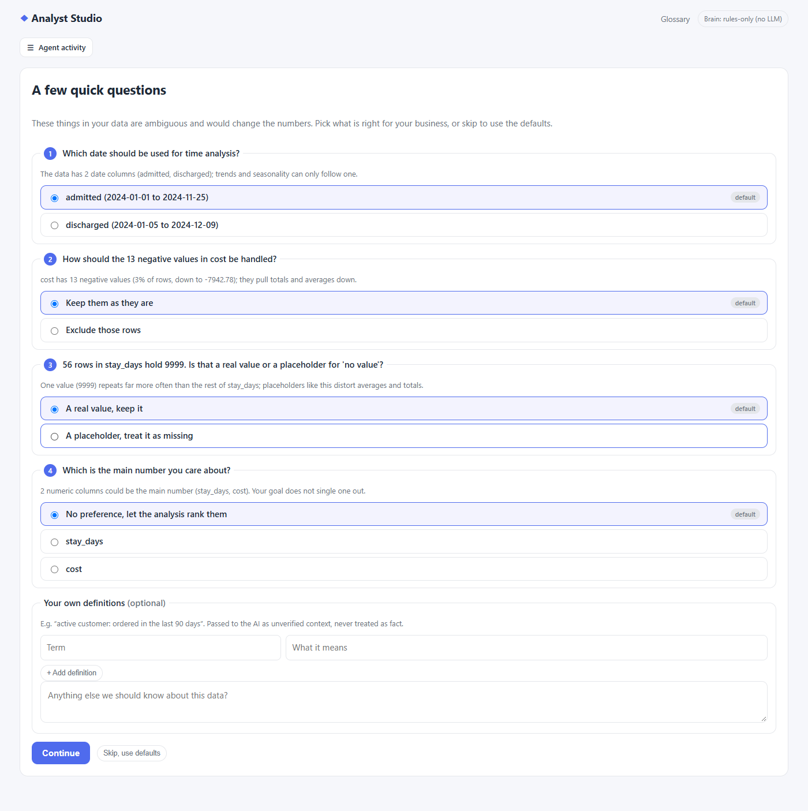
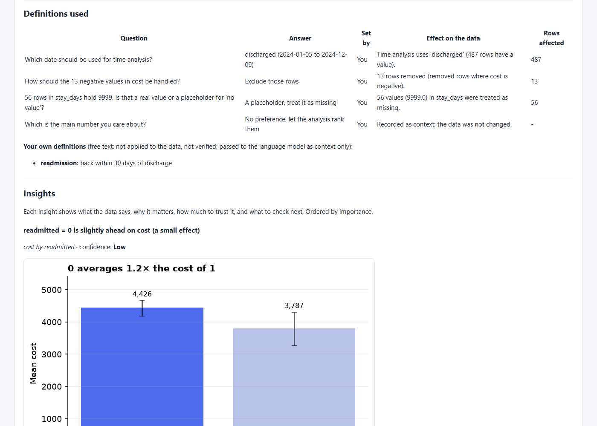
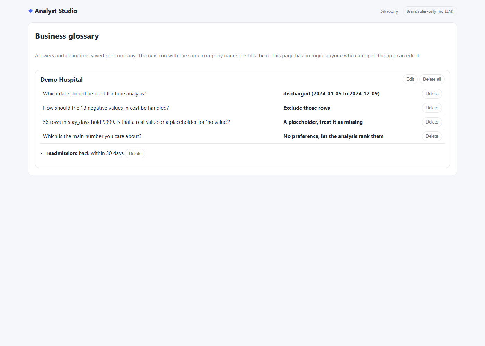

# Analyst Studio

An agentic data-analyst app. Upload a dataset, say **what you want to find out and why**, and a team of agents
profiles the data, plans only what your goal needs, cleans it (with a full audit log), runs the statistics, challenges
its own conclusions, and gives you a report plus a **Power BI starter pack**.

**Free to build and run.** The heavy lifting (profiling, cleaning, statistics, charts) is plain Python. The LLM only
plans, critiques and writes prose, and it can be a free local model, a free-tier API, or nothing at all.

```
 React UI ──upload + goal──▶ FastAPI ──▶ LangGraph workflow
    ▲                                       │
    └───── live agent events (SSE) ◀────────┤
                                            ▼
   Profiler → Joiner → Clarifier → Planner → Cleaner → Analyst → Critic ──┐ (needs a follow-up check?)
                                      ▲              │ yes
                                      └──────────────┘
                                         │ no
                                         ▼
                              Reporter → Power BI pack
```

| Agent | Job | Uses LLM? |
|---|---|---|
| **Profiler** | Detects the role of every column (id, numeric, binary, category, date, text), including numbers/dates stored as text | no |
| **Joiner** | With 2+ files (or Excel sheets): finds the key links, picks the analysis grain from your goal, joins safely, and measures every join | optional (can veto links) |
| **Clarifier** | Finds ambiguities from the data alone (two dates, placeholder values, negatives, derived or duplicate columns), asks a few short questions, and applies the answers through a closed list of actions | optional (writes the questions; templates otherwise) |
| **Planner** | Turns the goal into questions, picks the target and only the relevant columns, and chooses analyses | optional (rules fallback) |
| **Cleaner** | Fixes types, standardises missing values, removes duplicates, imputes, flags outliers, **only for needed columns**, logging every change | no |
| **Analyst** | Runs the planned analyses from a tested toolbox (tests, effect sizes, charts) | no |
| **Critic** | Multiple-testing correction, small samples, skew, practical vs statistical significance; can send the Analyst back for robustness checks | optional |
| **Reporter** | Assembles the report. The LLM only writes the summary and recommendations. Numbers come from the tools | optional |

Anything an LLM proposes is validated against the real columns. Hallucinated tools or columns are dropped, and
unusable output falls back to the rule-based planner.

## Tell it about the business (optional)

Expand **Tell us about the business** on the upload form: company, industry, what it does, the KPIs you care about, who reads the results, currency, and any notes.
Everything is optional and treated as *unverified background*, never as fact about the data. It is used to:

- **steer the analysis**: a KPI such as "average handle time" makes that column the target; industry presets add sensible questions and segments;
- **sharpen the wording**: why it matters, possible explanations and strategies speak in your business's terms (rules-only mode uses the industry lens; an LLM adds tailoring);
- **flag gaps**: a KPI you named that is not in the data, or data an industry usually needs (for example no date column for trend questions).

Not sure what to look for? Tick **I'm not sure what to look for**: the goal becomes optional and the agents explore the data broadly (extra analyses, a second target, heatmaps and per-segment trends).
If an LLM is enabled, the context text is sent to it, so leave out anything confidential.

## Business glossary and clarifying questions

Before planning, the Clarifier looks for things in the data that would change what a number *means*, asks a few short questions (**6 at most**), and applies the answers. It works on **any tabular data**: the question logic contains no word lists about any business domain and never looks at what a column is called (a test scans the code for domain words).

```
data -> signals.py (neutral facts) -> question writer -> validator -> you answer or skip -> cleaner executes the chosen actions
                                       LLM, or one generic
                                       template per signal
```

**Signals** (`signals.py`, values and distributions only): two or more date columns; several candidate measures; negative values in a column that is mostly positive; a placeholder-looking value (-1, 9999, 'unknown'…) or a spike of one value; a column that is almost exactly another plus or minus a third; very rare labels; high missingness; two columns that look like duplicates. Each has a stable id (hash of type + columns), so a saved answer matches the same ambiguity on the next run.

**Question writer.** With an LLM configured, it gets the compact profile, the signals, the goal, your business context and the saved glossary, and writes the questions. The prompt says: ask only when the answer changes what a number means; never ask which chart, grouping, column, time frame or view to show (the app analyses everything reasonable and ranks it); merge duplicates. With no LLM, or if its answer is unusable, one template per signal type produces the questions. A model that explicitly answers "nothing to ask" is respected.

**The closed list of actions.** Every option carries an action from a fixed list that *code* executes. Nothing an LLM writes is ever run.

| Action | Effect |
|---|---|
| `set_date_column` | the date used for time analysis |
| `set_measures` | the number(s) the analysis is built around |
| `define_derived_metric` | ratio of sums, or difference, of two measures (new column) |
| `filter_rows` | keep rows where `column <operator> value` holds (eq ne lt le gt ge in not_in is_null not_null) |
| `treat_value_as_missing` | placeholder values become missing in the analysis copy |
| `handle_negatives` | keep / exclude / net against another column (new column) |
| `drop_column`, `merge_columns` | leave a column out; combine columns (first non-null, or sum) |
| `note_only` | recorded as context for the LLM; the data is untouched |

**Validator.** Questions are dropped when they mention columns that do not exist, use an action outside the list or with invalid parameters, ask about scope (charts, segments, time frames…), or duplicate another question. The default answer of every question must leave the data unchanged (otherwise it is rewritten, or the question dropped), so **Skip, use defaults never changes a number**. Weak signals (rare labels, missingness…) only ride along when something stronger already needs an answer, and a question already settled by your goal (e.g. it names a date column) is not asked.

**Flow.** If a question needs an answer the run stops with status `needs_input` (the graph ends; no thread blocks) and the UI shows a form (radio options, your own definitions, notes, **Continue**, **Skip, use defaults**). Posting the answers restarts the run without repeating timeline events. Runs with nothing ambiguous are never blocked, nor are runs where the saved glossary already answers everything.

**What the answers do.** Actions run in the cleaner before any total is computed. Nothing is changed silently: original values are never edited (new columns are added, rows are filtered in the analysis copy), every effect is in the cleaning log with the rows or values affected, and an action that would remove every row is skipped and logged. The report gets a **Definitions used** section: answer, set by (*You / Default / Saved glossary / Your goal*), effect, rows affected. Free text that maps to no action (your definitions, notes, `note_only` answers) is passed to the LLM as *unverified* context and listed in the report as "not applied to the data".

**Glossary.** Answers are saved in `backend/data/glossary.json` (override with `GLOSSARY_PATH`) keyed by company name (lower-cased; `default` when no company is given), together with the option's label so the Glossary page reads naturally. The next run with the same company pre-fills them. Limits: 500 characters of notes, 300 per definition, 20 definitions per company. Writes are atomic and lock-protected.

| Endpoint | |
|---|---|
| `GET /api/runs/{id}/questions` | The questions to answer, with pre-filled values |
| `POST /api/runs/{id}/answers` | `{answers, notes, definitions, skip}`; `409` unless the run is `needs_input` |
| `GET /api/glossary[?workspace=]`, `PUT /api/glossary?workspace=`, `DELETE /api/glossary?workspace=` | Saved definitions |

> **The glossary API has no authentication.** Anyone who can reach the server can read, change or delete saved definitions, like the rest of this local-only app.





## Insights and strategies

Every chart comes with an insight card: a headline, **what we see**, **why it matters**, **how much to trust it** (confidence from effect size, multiple-testing correction, sample size and number of periods),
**possible explanations to test** (explicitly not conclusions) and **what to check next**. Descriptive charts (shares, distributions, Pareto) are labelled descriptive rather than "low confidence".

The **Strategy** tab turns only *significant, correction-surviving* findings into ranked, testable strategies: objective, actions, how to pilot it, KPIs to track, risks, impact, effort and time horizon, plus an impact/effort matrix.
If nothing in the data supports a lever, it says so ("No strong, data-backed lever was found") and offers foundation steps (close data gaps, track the KPI in Power BI) instead of inventing advice.
LLM output can only reword these; any number it introduces that is not in the findings is rejected and the rule-based text is kept.

## The dashboard, data viewer and ER diagram

- **Dashboard** (first tab): headline number tiles, the top recommendation, the two most important charts large, then every chart grouped by the question it answers (what drives the result, over time, shape of the data, tables). Filter by high confidence or your own KPIs; click any chart for its full insight card and *why this chart was chosen*.
- **Data**: browse the cleaned table the agents actually used (search, sort, paginate), switch to the original, see per-column *what cleaning changed* (type, missing values), and download the cleaned CSV.
- **Data model**: for several files, an ER diagram drawn from what the Joiner agent found: tables with their columns, key columns highlighted, 1 / N ends on each link, solid lines for links used, dashed for links skipped or rejected. Hover a line for the match rate and reason.

## Charts and tables the agents can choose from

Histogram, box plot, bar chart with error bars, Pareto, trend line, multi-line segment trends, weekday/month seasonality, correlation heatmap, two-way heatmap, scatter with fitted line (zooms past extreme points and says so), 100% stacked composition bars, plus a numeric summary table and a per-group table. The planner picks by column types and the goal; each chart records why it was chosen. An LLM, if enabled, can only choose from this list (anything invented is dropped).
Month-of-year seasonality is only claimed with at least two years of data, because with less it cannot be told apart from a trend.

## Several files? They get connected

Upload multiple files (or one Excel workbook with several sheets) and the **Joiner** agent:

1. **Finds links**: a key must be unique on one side and its values must appear on the other, with name evidence (`orders.customer_id` → `customers.customer_id`). Keys are normalised (`101` = `101.0` = `" 101 "`), and coincidental overlaps (two tables that both have `id` = 1..N, small numbers vs ids) are rejected.
2. **Picks the grain from your goal**: *"why do customers churn?"* → one row per customer; *"which segment drives revenue?"* → one row per order.
3. **Never multiplies rows**: many-to-one tables are joined in (orders get the customer's segment); one-to-many tables are **summarised first** (each customer gets `orders_count`, `orders_revenue_total`, `orders_days_since_order_date`, ...). Foreign keys are never averaged.
4. **Measures every join**: match rates, orphan rows, duplicate keys. A link where under 50% of rows match is skipped and reported, not forced.
5. **Shows its work**: the *Data model* tab and the report list tables, links, join steps and warnings, and the Power BI pack includes the original tables plus `relationships.csv` for native modelling.

Try `sample_data/shop/` (customers + orders + products) with *"Why do customers churn and which segment drives revenue?"*.

## Quick start

```bash
# 1. backend
cd backend
python -m venv .venv && source .venv/bin/activate      # Windows: .venv\Scripts\activate
pip install -r requirements.txt

# 2. frontend (needs Node 18+)
cd ../frontend && npm install && npm run build         # builds into frontend/dist

# 3. run everything on one port
cd ../backend && uvicorn app.main:app --port 8000
# open http://localhost:8000 and upload sample_data/sales.csv
```

Development mode with hot reload: run `uvicorn app.main:app --reload` in `backend/` and `npm run dev` in
`frontend/`, then open http://localhost:5173.

## Pick a free brain (optional)

With no setup it runs in **rules-only** mode and still produces a complete, honest report. For smarter goal
understanding and nicer summaries, choose one:

| Option | Setup |
|---|---|
| **Ollama** (local, offline, free) | Install from ollama.com, then `ollama pull qwen2.5:7b` and `pip install langchain-ollama` |
| **Gemini** (free tier) | Key from Google AI Studio, then `pip install langchain-google-genai` and `export GOOGLE_API_KEY=...` |
| **Groq** (free tier) | Key from console.groq.com, then `pip install langchain-groq` and `export GROQ_API_KEY=...` |

The provider is auto-detected (see `.env.example` to force one or change the model; free-tier model names change over
time, so set `LLM_MODEL` if the default is retired). The "Brain" pill in the top bar shows what is active.

**Privacy:** only aggregated metadata (column names, types, summary statistics, finding text, and the business context you typed) is sent to an LLM, never
raw rows. With Ollama nothing leaves your machine.

## Power BI

Power BI Desktop is Windows-only and `.pbix` is a proprietary binary, so the app does not pretend to generate one.
The **Power BI pack** (button in the UI, or `GET /api/runs/{id}/powerbi`) contains:

- `cleaned_data.csv` / `.parquet`: load with *Get data*
- `data_dictionary.csv`: detected types and recommended Power BI types
- `measures.dax`: ready-to-paste measures (totals, rates, shares, month-over-month, YTD)
- `visuals.json` + `POWERBI_GUIDE.md`: which visual to build for each finding, step by step
- `theme.json`: matching colour theme
- `report.md` + charts

Next step if you want it: push datasets straight to the Power BI service through its REST API (needs an Azure AD app
registration and a Power BI Pro licence, so it is not part of the free path).

## Tests

```bash
cd backend && pytest -q        # 155 tests: pipeline, API, edge cases, multi-table joins, business context, clarifying questions and glossary, insights, strategies, LLM failure modes (fake model, no network)
```

## Layout

```
backend/app/   profiler.py  relations.py  signals.py  clarify.py  directives.py  scope.py  glossary.py  planner.py  cleaner.py  tools.py  critic.py  reporter.py  powerbi.py
               graph.py (LangGraph)  llm.py (providers)  runner.py  main.py (FastAPI)
frontend/src/  App.tsx  components/{UploadForm,RunView,QuestionForm,Glossary,Timeline,Results}.tsx
sample_data/   sales.csv  churn.csv  shop/{customers,orders,products}.csv
```

## Known limits

- Charts are static images (PNG), not interactive: you can click to enlarge but not filter them. Power BI is the place for interactive slicing; the pack is built for that.
- Non-English column names need a system font that has those letters (Nirmala UI on Windows, Noto Sans elsewhere).

- **Local use only.** There is no authentication, and run folders live on disk (`backend/data/runs`). Add auth before exposing it.
- Joins use single-column keys (no composite keys) and never join many-to-many. A table that can only be reached through a summarised table (e.g. `products` when the grain is one row per customer) is reported as not used; ask a question at that level instead. Up to 8 files and 50 MB in total by default (`MAX_FILES`, `MAX_UPLOAD_MB`).
- Key detection is heuristic. It is conservative, and always shows the match rate, but check the *Data model* tab before trusting a surprising result.
- Associations, not causes. The report says so, and the Critic flags weak or small effects rather than recommending on them.
- Ambiguous `dd/mm` vs `mm/dd` dates: the order is inferred from the data; if every value is ambiguous, day-first is assumed and the cleaning log says so.
- Small local models (7B) plan less reliably than Gemini/Groq. That is why every plan is validated.
