# Analyst Studio

Upload your sales spreadsheets. Get a checked report, a dashboard and a chat assistant. No analyst needed.

> Demo video: **TODO** (link to be added)

## What it does

- **Reads your files.** It profiles up to several linked files, finds how they join, and works out what each column means.
- **Cleans with an audit log.** Every change to your data is listed, so you can see what was done and why.
- **Computes and checks the numbers.** Code runs the statistics, then challenges its own conclusions before they reach the report.
- **Gives you something to use.** A report, insights, ideas to try, a dashboard, and a Power BI starter pack. **Lens**, a chat assistant, answers questions and edits what each tab shows, with one-click Undo.


## How it works

```mermaid
flowchart LR
    B["Browser (React)"] -- "upload + goal" --> API["FastAPI"]
    API -- "live progress (SSE)" --> B
    API --> G
    subgraph G["LangGraph pipeline (14 stages)"]
        direction LR
        s1[profile] --> s2[relate] --> s3[brief] --> s4[understand] --> s5[clarify] --> s6[plan] --> s7[clean]
        s7 --> s8[analyze] --> s9[critic] --> s10[insights] --> s11[strategy] --> s12[report] --> s13[curate] --> s14[powerbi]
        s9 -. "challenge: re-run" .-> s8
    end
    AI["AI planner<br/>(picks from closed lists, words things)"] -. "column names, types, summaries only" .-> G
    G --> C["Code: computes and verifies every figure<br/>(pandas, scipy, citation check)"]
    C --> S[("Run folders<br/>plain files, no database")]
    B -- "questions" --> L["Lens<br/>plan, act, verify, answer"]
    L --> T["Tool registry<br/>data_query, report_facts, why_breakdown,<br/>summarise, custom_analysis, ..."]
    T --> S
    AI -.-> L
```




- **The AI never receives raw rows.** It sees column names, types, roles and summary statistics.
- **Code computes and verifies every figure**, on the whole cleaned table. The AI only proposes and words things.
- It picks from closed lists: tools, cleaning actions, query operations and view commands.
- Prose the AI writes is checked: each figure needs a fact id and must equal the computed value. A sentence that fails is dropped, and the rule-based sentence is kept.
- Every run is a folder of plain files. If an AI step fails, the stage falls back to rules and the run still finishes.

## Numbers

| What | Value | Source |
|---|---|---|
| Pipeline stages | 14 | `backend/app/graph.py` |
| Automated tests | 1,545 collected | `pytest --collect-only` (not run for this README) |
| Lens request set | 136 requests | `backend/tests/lens_eval/requests.jsonl` |
| Review pack R07: figures correct, before to after | TODO (10/12 to 12/12 not found in this repo's logs) | TODO |
| Review pack: Dashboard charts, before to after | TODO (about 45 to 5 not found in this repo's logs) | TODO |
| Token cost of one run (fake model, worst case) | about 14,000 tokens (12 columns), about 25,000 (50 columns) | `scripts/ai_tokens.py` |

More detail: [docs/evaluation.md](docs/evaluation.md).

## Quick start

```bash
# backend (Python 3.13)
cd backend
pip install -r requirements.txt -c constraints.txt
uvicorn app.main:app --reload          # API on :8000

# frontend, in a second terminal
cd frontend
npm install
npm run dev                            # page on :5173
```

- **Free AI key (optional).** Get a key from [Groq](https://console.groq.com), copy `.env.example` to `.env`, and set `GROQ_API_KEY`.
- **No key?** It still works. It runs on rules only and makes a full, honest report.
- **One port, production style:** `cd frontend && npm run build`, then `cd backend && python -m app`.
- Docker and hosting: see [DEPLOY.md](DEPLOY.md).
- The bundled sample run opens without a key and makes no AI call.

## Known limits

- Tested on up to 5 linked files. Limits: 8 files, 50 MB, 500,000 rows.
- AI answers vary between runs. When a step fails or is unavailable, code falls back to rules.
- Groq's free tier allows about 8,000 tokens a minute and a daily cap. Runs slow down or use rules when the cap is reached.
- Results show associations, not causes. Join detection uses single-column keys only.
- No database. Runs live in folders on disk, unencrypted. There is no run queue, and a restart loses runs in flight.
- The report text for the demo may read as generic.
- The Dockerfile has not been built yet. See [DEPLOY.md](DEPLOY.md).

## Tech stack

Python 3.13, FastAPI, LangGraph, pandas, SciPy, DuckDB, Groq LLMs, React 18, TypeScript, Vite.

More notes: [docs/DETAILS.md](docs/DETAILS.md), [docs/architecture.md](docs/architecture.md), [docs/dev/](docs/dev/).

## License

[MIT](LICENSE)
