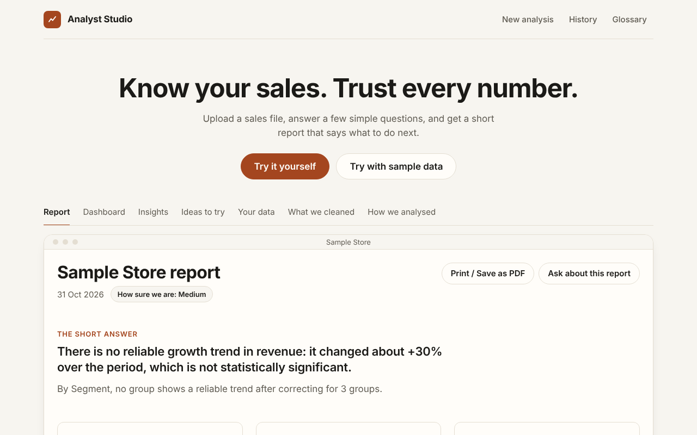
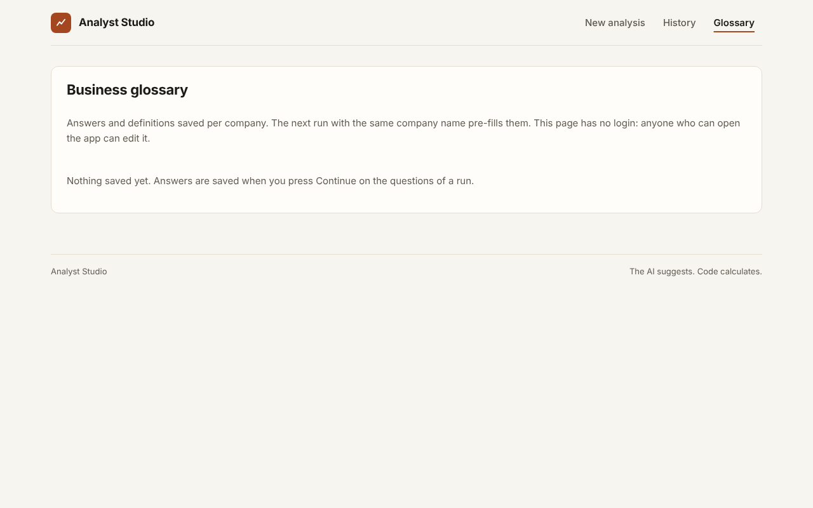
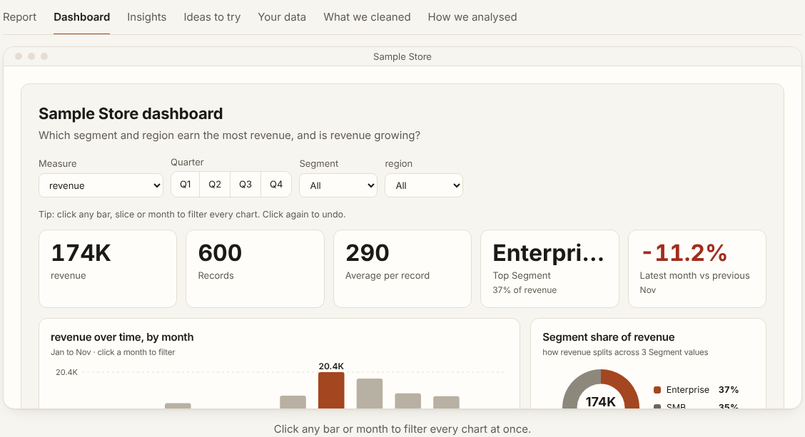
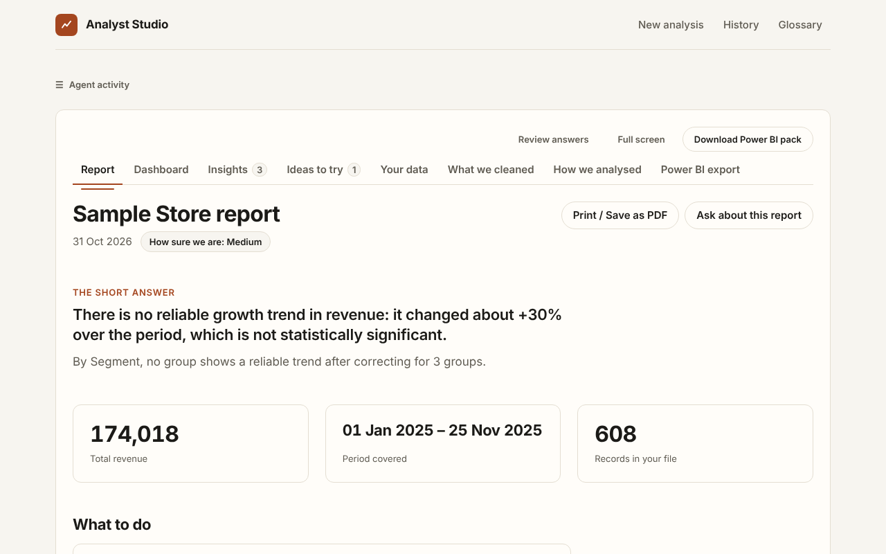
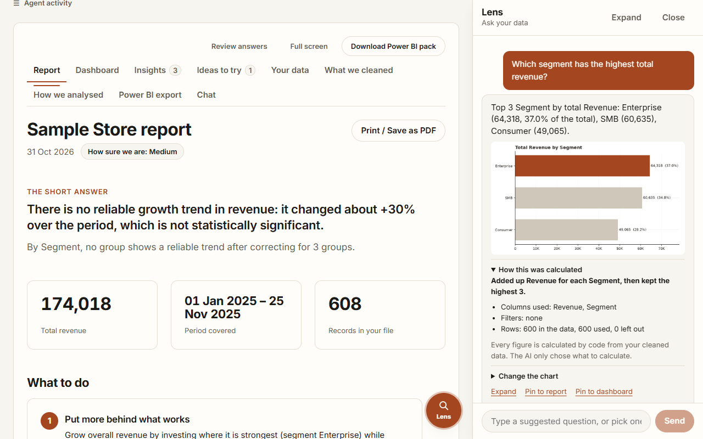

# Analyst Studio

An agentic data-analyst app. Upload a dataset, say **what you want to find out and why**, and a team of agents
profiles the data, plans only what your goal needs, cleans it (with a full audit log), runs the statistics, challenges
its own conclusions, and gives you a report plus a **Power BI starter pack**.

**Free to build and run.** The heavy lifting (profiling, cleaning, statistics, charts) is plain Python. The LLM only
plans, critiques and writes prose, and it can be a free local model, a free-tier API, or nothing at all.



```
 React UI ──upload + goal──▶ FastAPI ──▶ LangGraph workflow
    ▲                                       │
    └───── live agent events (SSE) ◀────────┤
                                            ▼
   Profiler → Joiner → Brief → Clarifier → Planner → Cleaner → Analyst → Critic ──┐ (needs a follow-up check?)
                                                         ▲              │ yes
                                                         └──────────────┘
                                                            │ no
                                                            ▼
                                  Insights → Strategist → Reporter → Power BI pack
```

The stage order lives in `backend/app/graph.py`. Every stage is wrapped so that a failure falls back to the rules version (or is skipped) with a warning, and the run still finishes with everything that exists.

| Agent | Job | Uses LLM? |
|---|---|---|
| **Profiler** | Detects the role of every column (id, numeric, binary, category, date, text), including numbers/dates stored as text | no |
| **Joiner** | With 2+ files (or Excel sheets): finds the key links, picks the analysis grain from your goal, joins safely, and measures every join | optional (can veto links) |
| **Brief** | One LLM call per run: what each column means (id, measure, dimension, date, text), whether a measure is additive or a rate, which column each KPI you named is, and which ratios or line totals exist. Every part is checked by code; a part that fails is dropped and the rules decide | optional (rules fallback) |
| **Clarifier** | Finds ambiguities from the data alone (two dates, placeholder values such as 999 or -1 found on the source tables before joining, negatives, derived or duplicate columns), asks **at most 3** short questions, and applies the answers through a closed list of actions | optional (writes the questions; templates otherwise) |
| **Planner** | Turns the goal into questions, picks the target and only the relevant columns, and chooses analyses | optional (rules fallback) |
| **Cleaner** | Fixes types, standardises missing values, removes duplicates, imputes, flags outliers, **only for needed columns**, logging every change | no |
| **Analyst** | Runs the planned analyses from a tested toolbox (tests, effect sizes, charts) | no |
| **Critic** | Multiple-testing correction, small samples, skew, practical vs statistical significance; can send the Analyst back for robustness checks | optional |
| **Insights** | Turns each finding into a card: what we see, why it matters, how much to trust it, explanations to test | optional (rules wording) |
| **Strategist** | Ranked, testable strategies from significant findings only | optional (rules wording) |
| **Reporter** | Assembles the report in three tiers. The LLM only writes the summary and recommendations. Numbers come from the tools | optional |
| **Power BI pack** | Cleaned data, data dictionary, DAX measures, visual specs, theme and guide | no |

Anything an LLM proposes is validated against the real columns. Hallucinated tools or columns are dropped, and
unusable output falls back to the rule-based planner.

## Tell it about the business (optional)

Expand **Tell us about the business** on the upload form: company, industry, what it does, the KPIs you care about, who reads the results, currency, and any notes.
Everything is optional and treated as *unverified background*, never as fact about the data. It is used to:

- **steer the analysis**: a KPI such as "average handle time" makes that column the target; industry presets add sensible questions and segments;
- **sharpen the wording**: why it matters, possible explanations and strategies speak in your business's terms (rules-only mode uses the industry lens; an LLM adds tailoring);
- **flag gaps**: a KPI you named that is not in the data, or data an industry usually needs (for example no date column for trend questions).

Not sure what to look for? Tick **I'm not sure what to look for**: the goal becomes optional and the agents explore the data broadly (extra analyses, a second target, heatmaps and per-segment trends).
If an LLM is enabled, the context text is sent to it, so leave out anything confidential.

## Business glossary and clarifying questions

Before planning, the Clarifier looks for things in the data that would change what a number *means*, asks a few short questions (**3 at most**, ranked by how much the answer changes the analysis; the rest use their defaults and the run says so), and applies the answers. It works on **any tabular data**: the question logic contains no word lists about any business domain and never looks at what a column is called (a test scans the code for domain words).

```
data -> signals.py (neutral facts) -> question writer -> validator -> you answer or skip -> cleaner executes the chosen actions
                                       LLM rewords, or one generic
                                       template per signal
```

**Placeholders** (`placeholders.py`) are looked for table by table before any join, because a 999 that is joined first gets averaged into a summary and can no longer be found. A column the analysis uses gets one question (default: treat as missing); an unused column is set to missing and logged without asking.

**Signals** (`signals.py`, values and distributions only): two or more date columns; several candidate measures (never a question: the planner analyses every one of them, see below); negative values in a column that is mostly positive; a placeholder-looking value (-1, 9999, 'unknown'…) or a spike of one value; a column that is almost exactly another plus or minus a third; very rare labels; high missingness; two columns that look like duplicates. Each has a stable id (hash of type + columns), so a saved answer matches the same ambiguity on the next run.

**Every question is anchored to a signal.** A question must carry the id of a signal that `signals.py` found in this data, and its options may only do what that kind of signal calls for (a placeholder can be treated as missing, not 'drop another column'). The LLM can only *reword* questions for signals that exist; anything it invents with no backing signal is dropped, even if its options would change the data. On data with nothing ambiguous the app asks 0 questions, with or without an LLM.

**Several measures, segments, periods, total vs average are never questions.** All candidate measures are analysed (distribution, trend, average per record and totals by segment, and one overview table). Every segment column and every period the data supports is analysed and shown. Ratios between measures are never invented by rules; see *Derived metrics* below.

**Question writer.** With an LLM configured, it gets the compact profile, the signals, the goal, your business context and the saved glossary, and writes the questions. The prompt says: ask only when the answer changes what a number means; never ask which chart, grouping, column, time frame or view to show (the app analyses everything reasonable and ranks it); merge duplicates. With no LLM, or if its answer is unusable, one template per signal type produces the questions. A model that explicitly answers "nothing to ask" is respected.

**The closed list of actions.** Every option carries an action from a fixed list that *code* executes. Nothing an LLM writes is ever run.

| Action | Effect |
|---|---|
| `set_date_column` | the date used for time analysis |
| `set_measures` | the number(s) the analysis is built around |
| `define_derived_metric` | ratio of sums, or difference, of two measures (new column) |
| `filter_rows` | keep rows where `column <operator> value` holds (eq ne lt le gt ge in not_in is_null not_null) |
| `treat_value_as_missing` | placeholder values become missing in the analysis copy |
| `handle_negatives` | keep / exclude / net against another column (new column) |
| `drop_column`, `merge_columns` | leave a column out; combine columns (first non-null, or sum) |
| `note_only` | recorded as context for the LLM; the data is untouched |

**Validator.** Questions are dropped when they have no backing signal, mention columns that do not exist, use an action outside the list or with invalid parameters, or duplicate another question. The check is **structural, not word-based**: a question is kept only if at least one answer changes the data (filter, drop, merge, placeholder, derived column, negatives) or picks the date. Questions whose answers are all notes, or just alternative columns, views, groupings, aggregations or time frames the app analyses anyway, are dropped whatever they say. The default answer of every question must leave the data unchanged (otherwise it is rewritten, or the question dropped), so **Skip, use defaults never changes a number**. Weak signals (rare labels, missingness…) only ride along when something stronger already needs an answer, and a question already settled by your goal (e.g. it names a date column) is not asked.

**Flow.** If a question needs an answer the run stops with status `needs_input` (the graph ends; no thread blocks) and the UI shows a form (radio options, your own definitions, notes, **Continue**, **Skip, use defaults**). Posting the answers restarts the run without repeating timeline events. Runs with nothing ambiguous are never blocked, nor are runs where the saved glossary already answers everything.

**What the answers do.** Actions run in the cleaner before any total is computed. Nothing is changed silently: original values are never edited (new columns are added, rows are filtered in the analysis copy), every effect is in the cleaning log with the rows or values affected, and an action that would remove every row is skipped and logged. The report gets a **Definitions used** section: answer, set by (*You / Default / Saved glossary / Your goal*; for the glossary, which workspace saved it and when, because the app has no user accounts), effect, rows affected. A saved answer is ignored (and listed as not applied) when its question is no longer asked for the data or the saved option no longer exists, and it is never shown to the question writer in that case. Free text that maps to no action (your definitions, notes, `note_only` answers) is passed to the LLM as *unverified* context and listed in the report as "not applied to the data".

**Glossary.** Answers are saved in `backend/data/glossary.json` (override with `GLOSSARY_PATH`) keyed by company name (lower-cased; `default` when no company is given), together with the option's label so the Glossary page reads naturally. The next run with the same company pre-fills them. Limits: 500 characters of notes, 300 per definition, 20 definitions per company. Writes are atomic and lock-protected.

| Endpoint | |
|---|---|
| `GET /api/runs/{id}/questions` | The questions to answer, with pre-filled values |
| `POST /api/runs/{id}/answers` | `{answers, notes, definitions, skip}`; `409` unless the run is `needs_input` |
| `GET /api/glossary[?workspace=]`, `PUT /api/glossary?workspace=`, `DELETE /api/glossary?workspace=` | Saved definitions |

> **The glossary API has no authentication.** Anyone who can reach the server can read, change or delete saved definitions, like the rest of this local-only app.



## Derived metrics (ratios) are proposed, then checked against the data

A ratio you name as a KPI (for example "profit margin") is created by code whenever the Brief, or the rules as a fallback, find its numerator and denominator columns. Beyond that, rules alone never invent a ratio. With an LLM, the planner may propose up to 2 more ratios A / B, and each proposal must come with a one-line business meaning and then pass checks that look at **values only** (`derived.py`, `derived_check.py`, no column names, no domain words):

| Check | Rejects |
|---|---|
| The ratio is not almost entirely a function of its denominator | \|spearman(A/B, B)\| > 0.8 (for example units divided by an amount, which just reproduces the inverse of the amount) |
| The two columns are on comparable scales | typical sizes more than about 50x apart |
| An id or count-like column is not divided by a continuous magnitude | small whole-number counts or ids over decimals |
| The denominator is positive in nearly every row | unstable divisors |

"Part of" ratios (A mostly within 0..B, a component over its total) rank first, at most two are kept, and a ratio is always a **ratio of sums** (total of A over total of B, per group and per period), never the mean of row ratios. Every created metric, with its meaning, and every rejected proposal, with the reason, is listed under **Definitions used** in the report and on the dashboard, where **Remove and re-run** repeats the analysis without it (`POST /api/runs/{id}/remove-derived`).

## The goal gets a direct answer

If the goal asks whether something is growing, falling or changing over time, the planner puts the overall trend and the per-group trends first, and the report opens with **Answer to your goal**: one sentence with the direction, the size of the change and its significance (for example "There is no reliable growth trend in amount: it changed about -5% over the period, which is not statistically significant (p=0.58, 24 months)"), plus one on the groups, corrected for the number of groups tested. The dashboard shows that sentence with the two trend charts above everything else.

## The report has three tiers

`tiering.py` arranges the same findings; it computes nothing new.

| Tier | Content |
|---|---|
| 1. The answer | One line per goal question (or "Not answered"), key numbers, up to 5 headline findings, up to 3 actions. Ranking facts ("which X is most Y") and growth facts (every group's first full period against the last, marked reliable or not) are built from the cleaned data, so they exist even when no difference was significant (`summary.py`) |
| 2. Evidence | Up to 8 cards: findings named by the goal, or significant after correction with a medium or larger effect |
| 3. Appendix | Everything else, collapsed. Non-significant tests become one "Checked, nothing found" line each; distributions and shares go to a data profile |

Numbers in the prose are checked against the findings; a number the tools did not compute is rejected and the rule-based text is kept. If an AI call failed (rate limit, timeout, auth), the report says so instead of presenting rules text as AI text.

## Charts show a readable slice; statistics always use all the data

Only the picture is trimmed. Every test, effect size, best/worst group and total is computed on every row and every group, and every trimmed chart says so on the chart itself ("showing top 8 of 17 groups; statistics use all 17"), in the finding text and in its stats.

| Chart | What is drawn |
|---|---|
| Ranking bars (group comparison) | up to 8 groups: all. More: top 8 by the plotted value, always including the best and worst group named in the headline, plus one **Other (k groups)** bar (the pooled mean or rate of the remaining rows; a ratio of sums for derived metrics). Horizontal bars when there are more than 6 or the labels are long, with the value and n beside each bar |
| Share charts (category share, Pareto, composition) | top 7 plus Other |
| Per-group trends | the 5 biggest groups, always including the fastest and slowest; every group with enough data is tested and the p-values are corrected for all of them |
| Heatmaps | the 6 x 6 biggest rows and columns, always including those of the best and weakest cell, which are found over all cells |
| Histograms | axis clipped at the 99th percentile with the number of values beyond it stated; a log axis for extreme skew |
| Tables | 10 rows, **Show all N** |
| Dashboard | the goal answer first, then the four highest-scoring findings; the rest under **More charts** |




## Insights and strategies

Every chart comes with an insight card: a headline, **what we see**, **why it matters**, **how much to trust it** (confidence from effect size, multiple-testing correction, sample size and number of periods),
**possible explanations to test** (explicitly not conclusions) and **what to check next**. Descriptive charts (shares, distributions, Pareto) are labelled descriptive rather than "low confidence".

The **Strategy** tab turns only *significant, correction-surviving* findings into ranked, testable strategies: objective, actions, how to pilot it, KPIs to track, risks, impact, effort and time horizon, plus an impact/effort matrix.
If nothing in the data supports a lever, it says so ("No strong, data-backed lever was found") and offers foundation steps (close data gaps, track the KPI in Power BI) instead of inventing advice.
LLM output can only reword these; any number it introduces that is not in the findings is rejected and the rule-based text is kept.

## The dashboard, data viewer and ER diagram

- **Tabs:** Dashboard, Insights, Strategy, Report, Data, Data model, Cleaning log, Plan, Power BI. A History view lists the 20 newest runs.
- **Dashboard** (first tab): headline number tiles, the top recommendation, the two most important charts large, then every chart grouped by the question it answers (what drives the result, over time, shape of the data, tables). Filter by high confidence or your own KPIs; click any chart for its full insight card and *why this chart was chosen*.
- **Data**: browse the cleaned table the agents actually used (search, sort, paginate), switch to the original, see per-column *what cleaning changed* (type, missing values), and download the cleaned CSV.
- **Data model**: for several files, an ER diagram drawn from what the Joiner agent found: tables with their columns, key columns highlighted, 1 / N ends on each link, solid lines for links used, dashed for links skipped or rejected. Hover a line for the match rate and reason.

## Charts and tables the agents can choose from

Sixteen tools in all (`tools.py`): distribution, outliers, category share, group compare, outcome compare, robust compare, Pareto, trend, correlation, heatmap, segment trend, scatter, composition, seasonality, summary table and group table. As charts: histogram, box plot, bar chart with error bars, Pareto, trend line, multi-line segment trends, weekday/month seasonality, correlation heatmap, two-way heatmap, scatter with fitted line (zooms past extreme points and says so), 100% stacked composition bars, plus a numeric summary table and a per-group table. The planner picks by column types and the goal; each chart records why it was chosen. An LLM, if enabled, can only choose from this list (anything invented is dropped).
Month-of-year seasonality is only claimed with at least two years of data, because with less it cannot be told apart from a trend.

## Several files? They get connected

Upload up to 8 files (or one Excel workbook with several sheets; each non-empty sheet becomes a table) and the **Joiner** agent:

1. **Finds links**: a key must be unique on one side and its values must appear on the other, with name evidence (`orders.customer_id` → `customers.customer_id`). Keys are normalised (`101` = `101.0` = `" 101 "`), and coincidental overlaps (two tables that both have `id` = 1..N, small numbers vs ids) are rejected.
2. **Picks the grain from your goal**: *"why do customers churn?"* → one row per customer; *"which segment drives revenue?"* → one row per order.
3. **Never multiplies rows**: many-to-one tables are joined in (orders get the customer's segment); one-to-many tables are **summarised first** (each customer gets `orders_count`, `orders_revenue_total`, `orders_days_since_order_date`, ...). Foreign keys are never averaged.
4. **Measures every join**: match rates, orphan rows, duplicate keys. A link where under 50% of rows match is skipped and reported, not forced.
5. **Shows its work**: the *Data model* tab and the report list tables, links, join steps and warnings, and the Power BI pack includes the original tables plus `relationships.csv` for native modelling.

Try `sample_data/shop/` (customers + orders + products) with *"Why do customers churn and which segment drives revenue?"*.

## Try it without uploading anything

Press **Try with sample data** on the start page. It opens a finished run of a small sales file (`sample_data/demo/sales_run/`, about 600 rows, a sample store): the same report, dashboard, data viewer, cleaning log and plan as a real run. The sample is **read-only**, makes **no AI calls** and needs no API key. **Try it yourself** opens a panel with the upload flow.

The start page is a product page: a headline, two buttons, then a framed window running the real app on the sample. Its tabs are the app's real tabs: **Report**, **Dashboard**, **Insights**, **Ideas to try**, **Your data**, **What we cleaned** and **How we analysed** (plus **How files connect** and **Power BI export** on runs that have them). Below it are a four-step "How it works" flow, a scroll story whose window follows the text, three trust statements, and what it can and can't do. A click on a tab overrides the scroll until the next step; with reduced motion the story is a plain list.

- **The report page** has the title, date and a "How sure we are" label; the short answer in large type; up to four key figures; **What to do** as numbered cards; **The evidence** (at most six charts, each with a one-line "What this means" and a Details toggle); and **Behind the numbers**, where everything else is folded away. The footer shows the mode (rules only, or AI-assisted).
- **Print / Save as PDF** includes or leaves out the summary and actions, key numbers, charts, tables, data-quality notes and evidence; sets the title, company, date and an optional note; and chooses A4 or Letter, portrait or landscape, colour or black and white. Your last choices are remembered in this browser only.
- **One look**: colours, six type sizes and the 4-point spacing scale are in `frontend/src/tokens.css`; the 1120 px / 720 px column and 12-column (4 on a phone) grid are in `layout.css`. Charts, tables and the dashboard share one style: the accent for the highlighted bar, warm greys for the rest, numbers right-aligned.

## Checking a report

`python scripts/report_check.py <run id>` reads a finished run and prints PASS or FAIL for seven rules: the recommendation lists are identical wherever they appear; no action is a bare fact; a "biggest" claim names the computed top group; no investment advice from size alone; the coverage warning appears exactly when under 70% of calendar days have data; no internal column names in the main view; and no hash links. The sample run passes all seven. Its tests use one good and one bad sample per rule.

Each run also keeps `ai_usage.json`: every AI call with its stage, input and output tokens (flagged as estimated when the provider gives no count), whether it was answered from a saved result, and its time. The report's data section has one line with the totals, and `scripts/scorecard.py` prints a per-stage table.

## Lens: ask your data

A round **Lens** button sits at the bottom right of every tab of a finished run. It opens a panel docked on the right (a bottom sheet on a phone), so the report stays readable beside it. **Expand** opens the same conversation as a full-width **Chat** tab; the two share one conversation. The conversation, its pins and the question count are saved with the run (`lens.json` in the run folder), so a reload brings them back.



**The AI chooses, code computes, every figure comes from code.** For each typed question the AI gets the data understanding record (column meanings, roles, display names, units), the date span of each date column, the name of the tab you are on and the last 6 turns, never rows and never values. It returns a structured query from a closed list: *aggregate* (sum, average, count, count distinct, with filters, group by and split by), *top or bottom N*, *share of total*, *compare two groups*, *change between two periods*, *trend over time*, *distribution* and *relationship between two measures*. Code then:

1. **checks** the query: the columns exist, their roles fit the operation (nothing numeric is grouped, nothing categorical is added up), values and periods exist in the data. A value the user named ("delhi") is matched to the real value; one that is in two columns becomes a clarifying question. A query that fails is rejected with a plain sentence (the AI gets one corrected try);
2. **runs** it on the whole cleaned table and counts every row it used or left out;
3. **writes the sentence** from the computed numbers (each figure is recorded, so what is shown can be compared with what was computed) and **draws the chart**.

The AI never writes a sentence that is shown as a result. Its only free text is a clarifying question with 2 or 3 choices (each choice is a complete query, so choosing one needs no further AI call), and, for an unsupported question, one short reason (dropped if it contains a number).

- **Each answer** is one plain sentence, the chart or table inside the message, and a **How this was calculated** toggle (the operation, the columns, the filters, rows in the data / used / left out and why, groups not shown). Each chart has **Expand**, **Pin to report**, **Pin to dashboard** and **Download image**. Pins appear in a section **Added by you from Lens** on the report page or the dashboard; they are copies kept in `lens.json`, the original report is never changed, and each can be removed.
- **Chart controls** in plain language: chart type (bar, line, stacked bar, share, histogram, scatter, table), time grain, top N, sort, filters and comparing periods. Say it ("make it monthly", "as a line", "top 5", "and for Delhi?") or use the **Change the chart** buttons under an answer; the buttons are applied by code with no AI call. A chart that does not fit the result ("scatter" for a total by city) gets a plain note and the sensible chart instead.
- **What to ask next**: after each answer, 2 or 3 suggested questions written from this run's own columns and values, each carrying its complete query.
- **Unsupported questions** are said plainly, with two questions that can be answered. If margin or profit is asked and the data has no cost column (and no profit or margin column), Lens says that margin can't be computed because the data has no cost column, before any AI call.
- **No-AI mode** (the sample report, or no key): the suggested questions map straight to queries; typed text is answered only when it IS a suggestion (same words, or a typo away), otherwise the suggestions are offered. Chart controls still work.
- **Cost**: Lens uses the same rate-limit handling and AI cache as the rest of the app, at most **2 AI calls per question** (the second only repairs a reply that was not JSON or a query that failed the checks), and a per-run cap of `LENS_MAX_QUESTIONS` (default 50) questions that use the AI. At the cap Lens says so; the suggested questions and chart controls still work. A per-day provider limit stops AI questions for ten minutes, says so, and then tries again.
- **Flag** `CHATBOT=auto` (default): on when an AI model is available, and always on for the sample run. `CHATBOT=on` shows it on every report (suggestions only without a model); `CHATBOT=off` hides it. The sample run never calls a model, even when one is configured.

The code is in `backend/app/lens/`: `context.py` (what the AI may see), `query.py` (the closed list and the checks), `engine.py` (the calculations and sentences), `render.py` (charts), `chips.py`, `chat.py` (the only place that talks to the AI), `store.py` (saved state). A new operation is one function in `engine.RUNNERS` and one entry in `query.OP_HELP`. `python scripts/lens_kaveri_check.py` asks the real model eight Kaveri questions and compares each answer with pandas (`scripts/lens_kaveri_check_out.txt`); `node scripts/lens_screenshots.js` drives the panel in a browser.

## Quick start

```bash
# 1. backend
cd backend
python -m venv .venv && source .venv/bin/activate      # Windows: .venv\Scripts\activate
pip install -r requirements.txt

# 2. frontend (needs Node 18+)
cd ../frontend && npm install && npm run build         # builds into frontend/dist

# 3. run everything on one port
cd ../backend && uvicorn app.main:app --port 8000
# open http://localhost:8000 and upload sample_data/sales.csv
```

Development mode with hot reload: run `uvicorn app.main:app --reload` in `backend/` and `npm run dev` in
`frontend/`, then open http://localhost:5173.

## Pick a free brain (optional)

With no setup it runs in **rules-only** mode and still produces a complete, honest report. For smarter goal
understanding and nicer summaries, choose one:

| Option | Setup |
|---|---|
| **Ollama** (local, offline, free) | Install from ollama.com, then `ollama pull qwen2.5:7b` and `pip install langchain-ollama` |
| **Gemini** (free tier) | Key from Google AI Studio, then `pip install langchain-google-genai` and `export GOOGLE_API_KEY=...` |
| **Groq** (free tier) | Key from console.groq.com, then `pip install langchain-groq` and `export GROQ_API_KEY=...` |

The provider is auto-detected (see `.env.example` to force one or change the model; free-tier model names change over
time, so set `LLM_MODEL` if the default is retired). The "Brain" pill in the top bar shows what is active.

**Privacy:** only aggregated metadata (column names, types, summary statistics, finding text, and the business context you typed) is sent to an LLM, never
raw rows. With Ollama nothing leaves your machine.

## Power BI

Power BI Desktop is Windows-only and `.pbix` is a proprietary binary, so the app does not pretend to generate one.
The **Power BI pack** (button in the UI, or `GET /api/runs/{id}/powerbi`) contains:

- `cleaned_data.csv` / `.parquet`: load with *Get data* (with several files, also the original tables and `relationships.csv`)
- `data_dictionary.csv`: detected types and recommended Power BI types
- `measures.dax`: ready-to-paste measures (totals, rates, shares, month-over-month, YTD)
- `visuals.json` + `POWERBI_GUIDE.md`: which visual to build for each finding, step by step
- `theme.json`: matching colour theme
- `report.md` + charts

Next step if you want it: push datasets straight to the Power BI service through its REST API (needs an Azure AD app
registration and a Power BI Pro licence, so it is not part of the free path).

## Tests

```bash
cd backend && pytest -q        # 737 tests: pipeline, API, edge cases, multi-table joins, clarifying questions and glossary, derived metrics, report tiers, run safety, LLM failure modes (fake model, no network)
```

**Scorecard.** `python scripts/scorecard.py [--dataset mall] [--runs N]` runs the real pipeline on a built-in test dataset (Kaveri, 3 files; or mall, 40 000 rows) and checks the report against a known answer in 12 checks. Both datasets were built for this project. Latest recorded results: Kaveri 12/12 and mall 12/12 (25 Oct 2026). See `docs/facts.md` for measured limits, timings and storage.

## Layout

```
backend/app/   profiler.py  relations.py  brief.py  signals.py  placeholders.py  clarify.py  directives.py  glossary.py  planner.py  derived.py  derived_check.py
               measures.py  polarity.py  retail_roles.py  cleaner.py  tools.py  critic.py  insights.py  strategy.py  summary.py  tiering.py  goal.py
               wording.py  reporter.py  powerbi.py  dashboard.py  graph.py (LangGraph)  llm.py (providers)  runner.py  events.py  main.py (FastAPI)
backend/tests/ 737 tests        scripts/  scorecard.py  make_mall.py        docs/  facts.md  decision_points.md  flow_audit.md
frontend/src/  App.tsx  tokens.css (colours, type and spacing: the only values new code uses)  layout.css (the grid)  components/ (StartPage = the product page, Dialog, UploadForm, QuestionForm, RunView, Results, ReportPage, lens/ (the Lens button, panel, Chat tab and pins), PrintPanel, BIDashboard, InsightCard, StrategyView, DataViewer, DataModel, Glossary, History, ...)
sample_data/   sales.csv  churn.csv  shop/{customers,orders,products}.csv  mall/ (40 000-row scorecard dataset with truth.json)  demo/sales_run/ (the read-only sample run)
scripts/       report_check.py  scorecard.py  landing_screenshots.js  design_notes.md  build_log.md
```

## Privacy: what is stored and where

Everything stays on the machine running the server.

| What | Where | Kept for |
|---|---|---|
| Your uploaded files (a copy, as received) | `backend/data/runs/<run id>/inputs/` | `RETENTION_DAYS` (30) |
| Cleaned and joined tables, the report, charts, Power BI pack, status and timeline | `backend/data/runs/<run id>/` | `RETENTION_DAYS` (30) |
| Answers and business context you typed | the run folder, and the company's entry in `backend/data/glossary.json` (`GLOSSARY_PATH`) | glossary: until you delete it |
| Lens conversation, pins and question count | `backend/data/runs/<run id>/lens.json` | with the run |
| Saved AI replies (keyed by the full prompt, model and temperature) | `backend/data/ai_cache/` (`AI_CACHE_DIR`; `AI_CACHE=off` turns it off) | until you delete the folder |

If an LLM is configured, only aggregated metadata is sent to it: column names, types, summary statistics, findings and the business context you typed. Raw rows are never sent. Lens sends your question, the column descriptions and the date spans (no rows, no values), the tab name and the last 6 turns of the conversation; the figures in an answer are never sent. Your business context is sent as-is, so leave out anything confidential. With no LLM configured nothing leaves the machine.

To delete everything, stop the server and remove `backend/data/`. To keep runs for less time, set `RETENTION_DAYS` (for example `7`); `0` keeps them forever.

## Known limits

- The sample run is built from `sample_data/sales.csv`, not the Kaveri dataset named in the design brief: Kaveri is not in this repository.
- Printing covers the report tab only. The cleaning log and plan are separate tabs and are not part of the printed report.
- Charts are static images (PNG), not interactive: you can click to enlarge but not filter them. Power BI is the place for interactive slicing; the pack is built for that.
- Non-English column names need a system font that has those letters (Nirmala UI on Windows, Noto Sans elsewhere).

- **Local use only.** There is no authentication or user separation, and run folders live on disk (`backend/data/runs`). Anyone who can reach the server can list recent runs and read any run whose id they have. Runs older than `RETENTION_DAYS` (30 by default) are deleted when the server starts and whenever a new run is created; a run still queued or running is never deleted. Run folders are 8 to 20 times the size of the input while they exist.
- **No run queue.** Each upload starts its own thread immediately; there is no cap, parallel runs were not tested, and a server restart loses runs in flight (they stay `running` or `queued`).
- **Size.** Each table is limited to `MAX_ROWS` rows (500 000 by default). A larger file is refused at upload with a message that gives its row count and the limit. There is no column limit, and only 8 files and 50 MB in total. The largest dataset tested is 40 000 rows by 13 columns, which took about 1.5 to 2.5 minutes on the Groq free tier; most of that time is LLM calls and chart rendering, not row processing. Much larger files are untested and the whole upload is held in memory.
- **Formats.** `.xls` is accepted by the upload check but needs `xlrd`, which is not in `requirements.txt`; save as `.xlsx` instead. `.json` must be table-shaped.
- **Free-tier LLMs** rate-limit and sometimes time out (60 s timeout, one retry). The app then falls back to rules for that step and says so in the report; runs get slower and less tailored but still finish.
- **Retail-centred helpers.** Detecting quantity times price as an amount (`retail_roles.py`) and the test datasets are retail. Detection uses values, not column names, and the module is swappable, but other domains get only the generic path.
- Joins use single-column keys (no composite keys) and never join many-to-many. A table that can only be reached through a summarised table (e.g. `products` when the grain is one row per customer) is reported as not used; ask a question at that level instead. Up to 8 files and 50 MB in total by default (`MAX_FILES`, `MAX_UPLOAD_MB`).
- Key detection is heuristic. It is conservative, and always shows the match rate, but check the *Data model* tab before trusting a surprising result.
- Associations, not causes. The report says so, and the Critic flags weak or small effects rather than recommending on them.
- Ambiguous `dd/mm` vs `mm/dd` dates: the order is inferred from the data; if every value is ambiguous, day-first is assumed and the cleaning log says so.
- Small local models (7B) plan less reliably than Gemini/Groq. That is why every plan is validated.
