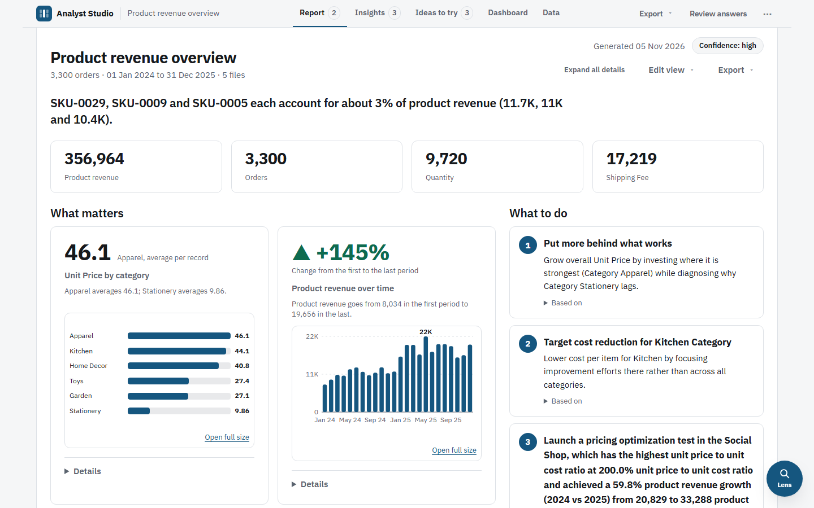
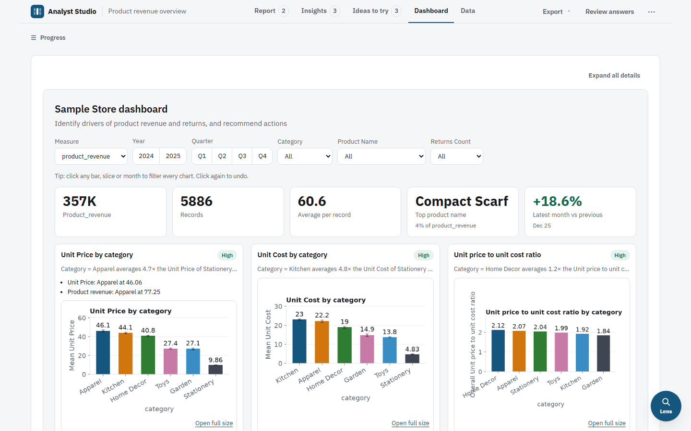
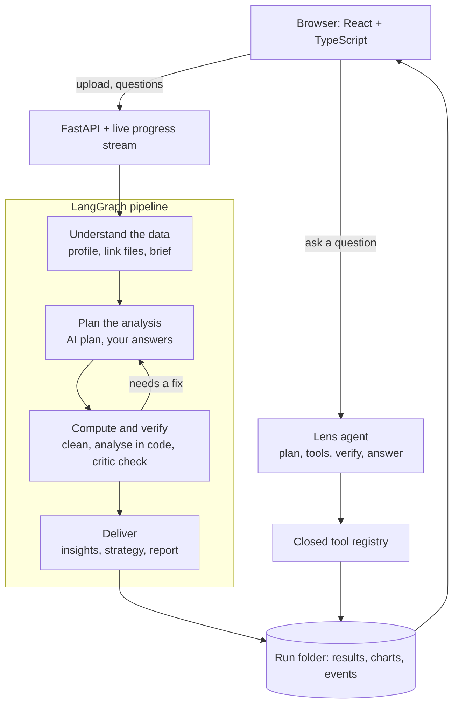
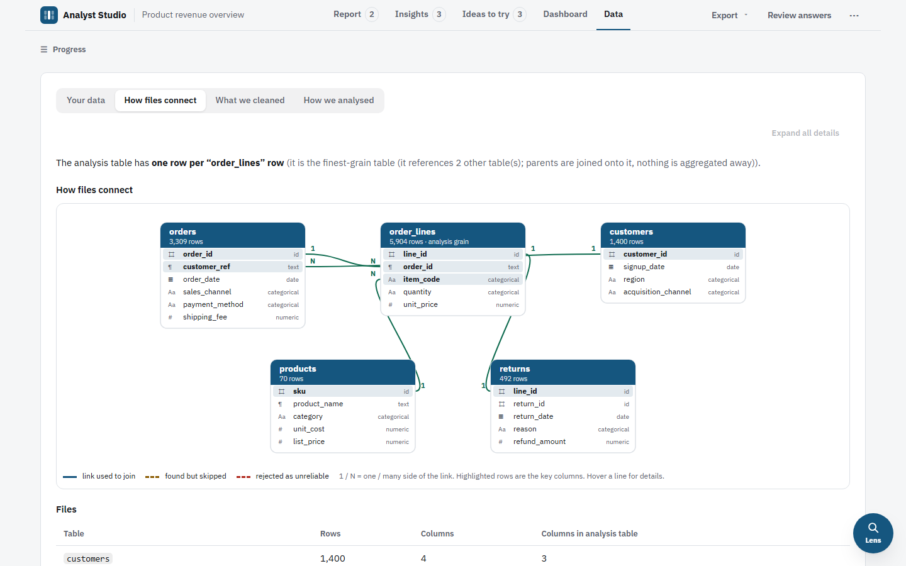

# Analyst Studio

**An AI data analyst for small vendors.** Upload your sales files and get a verified report, a dashboard and plain-English insights. The AI never receives your raw rows, and code checks every figure it quotes.




## What it does

- **Connects several files** (for example orders, products, customers, returns) by matching keys, even when column names differ.
- **Cleans the data** and logs every change in plain words.
- **Asks a few questions** only when the answer would change the numbers.
- **Plans the analysis with an LLM**, runs it in code, and checks the results.
- **Shows what matters** in a curated Report, Dashboard, Insights and Ideas to try, instead of dozens of charts.
- **Lens**: ask questions about any tab in plain language.
- **Exports**: PDF, report.md, cleaned data, Power BI pack.



## Agentic by design

- **The pipeline** is a multi-stage LangGraph workflow. LLM stages plan and write, code stages compute, and a critic stage reviews the work and sends it back for fixes.
- **Lens** is a tool-using agent. It plans, calls a fixed registry of verified tools, checks that every cited number exists, then answers.

The agents can only use tools from a closed list. They work from summaries, not raw rows. If the AI fails, the app falls back to rule-based analysis and says so.

## How it works



**Pipeline stages (14):** profile → relate → brief → understand → clarify → plan → clean → analyze → critic → insights → strategy → report → curate → powerbi

**The rule everything follows:** the AI proposes, code computes, code verifies. Every number in the Report comes from code. A quoted figure that cannot be found in the data is dropped.

Connected files are shown as a diagram, so you can see how they link:



## Numbers

- **14** pipeline stages, **1,545** automated tests.
- **Demo sample:** 5 linked files, 3,300 orders, 356,964 revenue. Nine headline figures in the Report are checked against values computed independently with pandas, and all nine match.


## Limits

| | Default | Public demo |
|---|---|---|
| Files per run | 8 | 8 |
| Upload size | 50 MB | 20 MB |
| Rows | 500,000 | 500,000 |
| AI runs per day | 100 | 5 to 10 |
| Runs kept for | 30 days | 3 days |

No database: each run is a folder on disk, deleted automatically after the retention period. On the hosted demo, uploads need an access code; the sample stays open to view.

## Quick start

```bash
# backend
cd backend
python -m venv .venv
.venv\Scripts\activate          # macOS/Linux: source .venv/bin/activate
pip install -r requirements.txt -c constraints.txt

# frontend (build once)
cd ../frontend
npm ci
npm run build

# run
cd ../backend
python -m app                   # http://localhost:8000
```

A free [Groq](https://console.groq.com) key makes the AI stages work: set `GROQ_API_KEY` in your environment. Without a key the app still runs, on rule-based analysis only. See [DEPLOY.md](DEPLOY.md) to host it.

## Known limits

- Tested on up to 5 linked files and on one large single file. Other shapes are untested.
- AI answers vary between runs. When the AI fails, code falls back to rules, and the run says so.
- Free-tier Groq has daily token limits, so a full AI run takes a few minutes.

## Tech

FastAPI, Server-Sent Events, LangGraph, Groq (`openai/gpt-oss-120b`), pandas, DuckDB, React 18, TypeScript, Vite.
