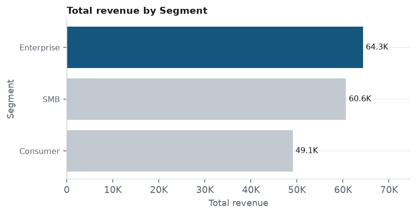
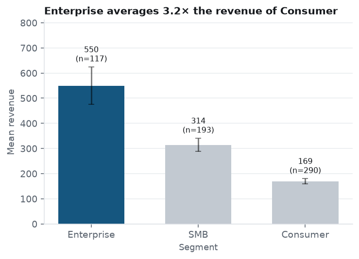
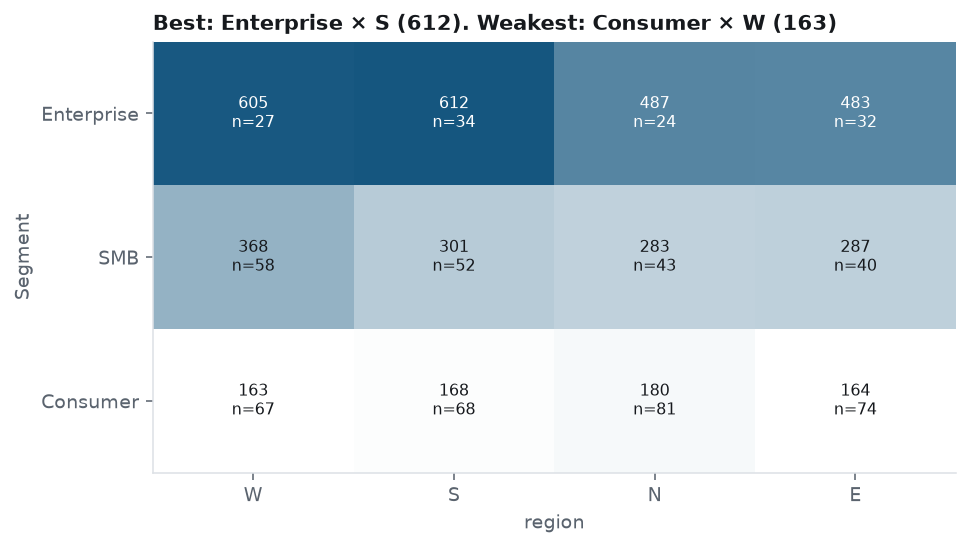
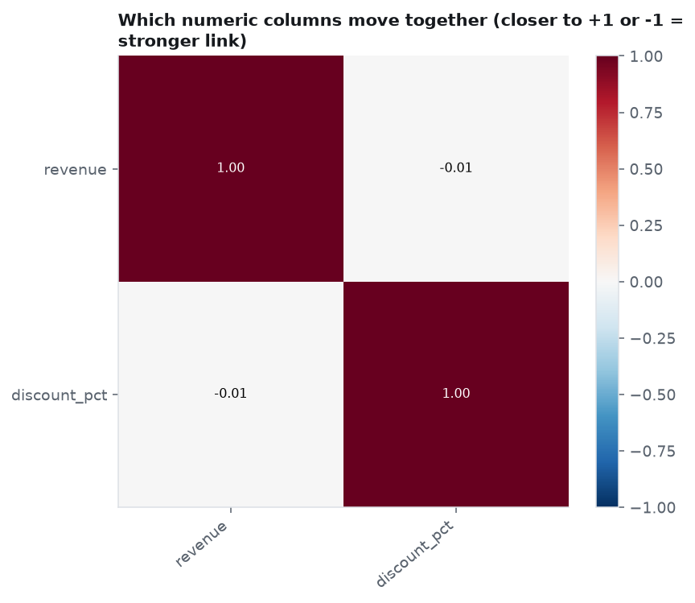

# Analysis report: Sample Store

**Mode:** Rules only

## Executive summary

### Answers

**1. Which segment and region earn the most revenue, and is revenue growing?**

Top 3 Segment by total revenue: segment Enterprise 64.3K (37%), segment SMB 60.6K (35%), segment Consumer 49.1K (28%)  
Biggest change in revenue by Segment, 2025Q1 vs 2025Q3: segment Enterprise +59% (14.8K to 23.5K), not statistically reliable  

*How to read this: Highest: Enterprise at 64.3K; lowest: Consumer at 49.1K. The gap is small.*

Trust: **Medium**: the growth figure is not statistically reliable

Details

- Full answer: Top 3 Segment by total revenue: segment Enterprise 64,318 (37.0%), segment SMB 60,635 (34.8%), segment Consumer 49,065 (28.2%). Top 3 region by total revenue: region W 48,607 (27.9%), region S 47,926 (27.5%), region E 39,036 (22.4%).
- Top 3 Segment by total revenue: segment Enterprise 64,318 (37.0%), segment SMB 60,635 (34.8%), segment Consumer 49,065 (28.2%)
- Top 3 region by total revenue: region W 48,607 (27.9%), region S 47,926 (27.5%), region E 39,036 (22.4%)
- Growth in total revenue by Segment, 2025Q1 vs 2025Q3 (first and last full periods): segment Enterprise +58.9% (from 14,766 to 23,457), not statistically reliable; segment SMB +50.5% (from 12,157 to 18,297), not statistically reliable; segment Consumer +17.8% (from 12,991 to 15,309), not statistically reliable. Reliability is a Welch test on monthly totals, corrected for 3 groups.

### What to do

1. Put more behind what works: Segment = Enterprise: Grow overall revenue by investing where it is strongest (segment Enterprise) while diagnosing why segment Consumer lags. *(question 1)*

   

   *Supported by: Segment = Enterprise averages 3.2× the revenue of Consumer (average 550 per record vs 169 for Consumer) (large effect)*

## Key numbers

| Total revenue | Period covered | Rows | Columns |
|---|---|---|---|
| **174,018** | **01 Jan 2025 – 25 Nov 2025** | **608** | **7** |

---

**View more**

Answer details: exact figures, facts and statistics

**1. Which segment and region earn the most revenue, and is revenue growing?**

- Answer: Top 3 Segment by total revenue: segment Enterprise 64,318 (37.0%), segment SMB 60,635 (34.8%), segment Consumer 49,065 (28.2%). Top 3 region by total revenue: region W 48,607 (27.9%), region S 47,926 (27.5%), region E 39,036 (22.4%).
- r1: By total revenue, segment Enterprise is highest at 64,318 (37.0% of the total revenue) and segment Consumer is lowest at 49,065.
- r3: By total revenue, region W is highest at 48,607 (27.9% of the total revenue) and region N is lowest at 38,449.

**Headline findings**

- By total revenue, segment Enterprise is highest at 64,318 (37.0% of the total revenue) and segment Consumer is lowest at 49,065 (r1)
- By total revenue, region W is highest at 48,607 (27.9% of the total revenue) and region N is lowest at 38,449 (r3)
- No reliable trend in revenue over time (f1)
- Segment = Enterprise averages 3.2× the revenue of Consumer (average 550 per record vs 169 for Consumer) (large effect) (f4)

**Written summary**

**Answer to your goal.** There is no reliable growth trend in revenue: it changed about +30% over the period, which is not statistically significant (p=0.08, 11 months). By Segment, no group shows a reliable trend after correcting for 3 groups.

**Goal:** Which segment and region earn the most revenue, and is revenue growing?

The dataset has 608 rows and 7 columns. The agents focused on **revenue**. 18 analyses were run and 9 of them were tested for significance. 1 showed statistically significant patterns; 1 remains significant after correcting for 6 comparisons.

Evidence (3 findings)

The 3 findings that matter most: named by your goal, or still significant after correction with a medium or larger effect. Ordered by importance.

### Segment = Enterprise averages 3.2× the revenue of Consumer (average 550 per record vs 169 for Consumer) (large effect) ✅

*revenue by Segment* · confidence: **High** · f4, f11, f18

**What we see.** Average **revenue** is highest for **Segment = Enterprise** (550) and lowest for **Consumer** (169). The difference is statistically significant (ANOVA p<0.001, eta²=0.301, large effect).

**Why it matters.** Enterprise is where revenue is strongest and Consumer where it is weakest. That points to putting more promotions and bundles behind what already works, and finding out what is holding Consumer back.

**How much to trust it.** Still significant after correcting for the number of comparisons made. Large effect size, so the difference is big enough to matter. Based on 600 rows.

- Median check (Kruskal-Wallis): the difference holds, p<0.001.

Per-group figures: revenue by Segment (table)

| Group | Rows | Average | Median | Total | Share of total |
|---|---|---|---|---|---|
| Enterprise | 117 | 550 | 468 | 64.3K | 37% |
| SMB | 193 | 314 | 259 | 60.6K | 35% |
| Consumer | 290 | 169 | 151 | 49.1K | 28% |

**Possible explanations to test (not conclusions):**
- segment Enterprise may differ in mix, for example in `region` or `discount_pct`
- Another column could be driving both Segment and revenue (a confounder)

**Check next:**
- Check whether the Enterprise vs Consumer gap holds inside other splits (e.g. region, product) before acting
- Pilot any change on part of the group, with the rest as a control

### Enterprise × S stands out (average 612 per record); Consumer × W is weakest (average 163 per record)

*revenue: Segment × region* · confidence: **Exploratory** · f6

**What we see.** Across **Segment** and **region**, **revenue** is highest for **Enterprise × S** (612) and lowest for **Consumer × W** (163), a 3.8× gap. Only combinations with at least 10 rows are shown; these cell-level gaps are not individually tested, so treat them as leads to check rather than proven differences.

**Why it matters.** Segments can behave differently in combination, and single-column averages hide it. This shows where to look first, not what to do.

**How much to trust it.** Individual cells are not statistically tested; use them as leads to check. Based on 600 rows split into 12 cells.

**Possible explanations to test (not conclusions):**
- A combination may reflect a specific product, channel or customer type
- Small cells can swing widely by chance

**Check next:**
- Check the best and worst combinations with a proper test before building a plan around them

### No strong relationships between the numeric columns

*Relationships between numeric columns* · confidence: **Low** · f7

**What we see.** Strongest relationships: revenue & discount_pct: r=-0.01; revenue & revenue: r=nan; discount_pct & revenue: r=nan. Correlation shows columns move together, not that one causes the other.

**Why it matters.** None of the numeric columns tracks another closely, so no obvious single lever or shortcut indicator shows up.

**How much to trust it.** Strongest correlation is r = 0.01. Correlation does not show cause and effect.

**Possible explanations to test (not conclusions):**
- A hidden common cause may drive both
- The relationship may only hold in some segments

**Check next:**
- Test whether changing one actually moves the other (a controlled pilot) before treating it as a lever

Growth in revenue by Segment, 2025Q1 vs 2025Q3

- segment Enterprise +58.9% (from 14,766 to 23,457)
- segment SMB +50.5% (from 12,157 to 18,297)
- segment Consumer +17.8% (from 12,991 to 15,309)

*Lines without 'statistically reliable' are not statistically reliable (Welch test on sub-period totals, corrected for the number of groups).*

Growth in revenue by region, 2025Q1 vs 2025Q3

- region W +82.8% (from 8,912 to 16,296)
- region S +46.6% (from 9,817 to 14,388)
- region E +47.2% (from 9,170 to 13,500)
- region N +7.2% (from 12,014 to 12,880)

*Lines without 'statistically reliable' are not statistically reliable (Welch test on sub-period totals, corrected for the number of groups).*

Checked, nothing found (8)

Checked, nothing found: tested and not statistically significant, so no reliable pattern.

- No reliable trend in revenue over time (p=0.081) (f1)
- Trends in revenue do not differ reliably across Segment (p=0.18) (f2)
- revenue does not differ reliably across region (p=0.11) (f5)
- No reliable relationship between discount_pct and revenue (p=0.51) (f9)
- No reliable weekday pattern in revenue (p=0.17) (f10)
- No reliable trend in discount_pct over time (p=0.84) (f13)
- discount_pct does not differ reliably across Segment (p=0.36) (f14)
- discount_pct does not differ reliably across region (p=0.15) (f16)

Strategy and Recommendations

**Top recommendations**

1. Put more behind what works: Segment = Enterprise: Grow overall revenue by investing where it is strongest (segment Enterprise) while diagnosing why segment Consumer lags. *(question 1)*

1 data-backed strategy, ranked by expected impact, confidence and effort. Each is a hypothesis to test with a small pilot first: the analysis shows association, not cause.

### 1. Put more behind what works: Segment = Enterprise

*Data-backed · impact: **High** · effort: **Medium** · timeline: **Next quarter (30-90 days)** · confidence: **High** · based on f4*

**Objective.** Grow overall revenue by investing where it is strongest (segment Enterprise) while diagnosing why segment Consumer lags.

**Actions**
1. Direct more promotions and bundles to segment Enterprise and track revenue for it.
2. Find out why segment Consumer lags: compare it with segment Enterprise on `region` or `discount_pct`.
3. Decide whether to lift segment Consumer or deliberately shift resources toward segment Enterprise.

**How to test it first.** Pilot the extra investment on part of Enterprise (or a comparable subset) for 4-8 weeks with a hold-out group, and compare revenue between them.

**KPIs to track:** revenue for Enterprise and for Consumer; Share of total revenue coming from segment Enterprise; Pilot vs hold-out difference

**Risks**
- segment Enterprise may already be near its ceiling, so extra spend could show diminishing returns.
- The gap may partly reflect differences in mix rather than the group itself.

**Foundations**

- Close the most important data gaps: Close these gaps from this run: No product cost or margin data; No acquisition channel or campaign data.
- Make this repeatable: track the main KPI in Power BI: Turn a one-off analysis into a regular review so changes are seen early.

How the data was set up (business, sources, cleaning)

**AI usage:** no AI calls in this run (rules only).

**Data concerns:** found by rule checks (no AI configured).

### About the business (as you described it)

- **Company:** Sample Store
- **Industry lens used:** retail
- **Audience:** you (the business owner) (default: you did not name another audience)
- This context steers what is analysed and how it is worded. It is not verified against the data.

### What we set out to answer

**Objective:** Which segment and region earn the most revenue, and is revenue growing?

- What explains differences or changes in revenue?
- Which segments (Segment, region) perform best and worst on revenue?
- Is revenue trending up or down over time?

### Data and cleaning

608 rows × 7 columns. Columns used: `revenue`, `Segment`, `region`, `order_date`, `discount_pct`.

- **Standardise missing values**: Trimmed whitespace and converted placeholders like 'N/A', 'null', '-' to real missing values
- **Convert to date**: 'order_date' parsed as dates, order inferred as day-first (dd/mm/yyyy). Each value was parsed on its own, so mixed formats are handled. Range: 01 Jan 2025 to 25 Nov 2025.
- **Convert to number**: converted 608 values in revenue (currency words/symbols, thousands separators and spaces stripped)
- **Remove duplicates**: Dropped 8 exact duplicate rows
- **Scope to the goal**: Columns not needed for this goal were left untouched and excluded from analysis: order_id, notes
- **Impute numeric**: 'discount_pct': 24 blank values (4.0%) filled with the median (14.35)
- **Flag outliers**: 'revenue': 37 values (6.2%) outside 1.5×IQR. Flagged, NOT removed - they may be real

Statistics and limitations

**Data gaps and what would sharpen this**

- **No product cost or margin data.** Typical for e-commerce / retail analysis, and it would let the agents test more explanations. *Consider adding product cost or margin.*
- **No acquisition channel or campaign data.** Typical for e-commerce / retail analysis, and it would let the agents test more explanations. *Consider adding acquisition channel or campaign.*
- **No returns or refunds data.** Typical for e-commerce / retail analysis, and it would let the agents test more explanations. *Consider adding returns or refunds.*

**Reliability and limitations**

- 6 comparisons were run; Bonferroni-adjusted p-values are shown to limit false positives.
- 'revenue by Segment' also holds with a median-based test (robust).
- These are statistical associations in observational data; they do not prove cause and effect. Strategies are hypotheses to test.

Appendix

Data profile (3 lines)

**Distributions**

- revenue: typical value 217, with half of rows between 137 and 367.
- Summary of 2 numeric columns.

**Outliers (one line per column)**

- **revenue:** 37 of 600 values (6.2%) lie above the upper fence (711).

Per-group figures: discount_pct by Segment (table)

| Group | Rows | Average | Median |
|---|---|---|---|
| SMB | 193 | 15.1 | 14.4 |
| Enterprise | 117 | 14.7 | 14.7 |
| Consumer | 290 | 14 | 14.3 |

Per-group figures: revenue by region (table)

| Group | Rows | Average | Median | Total | Share of total |
|---|---|---|---|---|---|
| W | 152 | 320 | 235 | 48.6K | 28% |
| S | 154 | 311 | 226 | 47.9K | 28% |
| E | 146 | 267 | 213 | 39.0K | 22% |
| N | 148 | 260 | 194 | 38.4K | 22% |

Power BI

A ready-to-load Power BI pack (cleaned data, data model, DAX measures and visual specs) was generated alongside this report.

