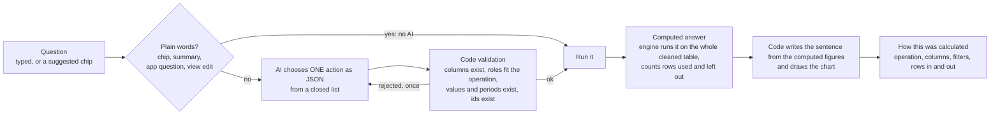
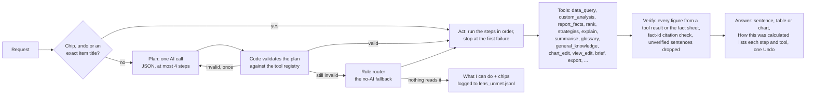

# Architecture

Analyst Studio has one rule: **the AI proposes, code verifies.** Everything that is a number, a ranking, a trust label or a chart is produced by Python on the whole cleaned table. The AI chooses what to look at and may reword, and everything it says is checked against what code computed.

## The pipeline

The stage order lives in `backend/app/graph.py` (a LangGraph workflow). Every stage is wrapped: if it fails, the rules version runs or the stage is skipped with a warning, and the run still finishes.

```mermaid
flowchart LR
    U[Upload + goal] --> P[Profile<br/>column roles, types]
    P --> R[Relate<br/>find keys, join safely]
    R --> B[Brief<br/>what the goal and business context mean]
    B --> UN[Understand<br/>meaning, role and display name of every column]
    UN --> C[Clarify<br/>at most 3 questions, anchored to a signal]
    C -->|needs answers| Q[(You answer or skip)]
    Q --> C
    C --> PL[Plan<br/>only analyses the goal needs]
    PL --> CL[Clean<br/>closed list of actions, full audit log]
    CL --> A[Analyze<br/>tests, effect sizes, charts]
    A --> CR{Critic<br/>weak, small or needs follow-up?}
    CR -->|follow-up check| A
    CR -->|ok| I[Insights<br/>confidence from effect, correction, sample, periods]
    I --> S[Strategy<br/>only significant, correction-surviving findings]
    S --> RP[Report<br/>short answer, actions, evidence]
    RP --> PB[Power BI pack]
```

Which stages use an AI model, and what each may and may not do:

| Stage | AI may | Code always |
|---|---|---|
| Profile, Relate | veto a proposed key link (optional) | detects roles, measures every join (match rate, orphans) |
| Brief, Understand | read the goal and name columns | validates every column it names exists |
| Clarify | reword the questions | produces questions from signals in the data, validates each action against a closed list |
| Plan | suggest analyses | drops tools and columns that do not exist; falls back to the rule planner |
| Clean | nothing | executes the chosen actions and logs every change |
| Analyze, Critic | the critic may ask for a follow-up | runs every test, applies multiple-testing correction |
| Insights, Strategy, Report | reword text | recomputes every figure; a number the tools did not compute is rejected and the rule-based text is kept |

## Lens, the chat

Lens answers questions about a finished run. The AI never writes a sentence that is shown as a result.

The same closed-list idea covers view edits (hide, short view, top N, rename, pin, move, chart type): the AI returns a command, `viewedit.py` validates that the item or section exists and applies it, and one-click Undo reverses it.

## The Lens agent loop

Lens is a plan-act-verify-answer loop over a registry of general tools. Nothing in the loop knows a request type, an audience or a column: a request is a plan of tools.

`custom_analysis` is the one place the AI writes code, so it is the most restricted: the SQL is parsed, not scanned for words; what runs is regenerated from the parse tree; it reads one registered read-only view, with external access off, a timeout, a memory cap and row caps; and an error goes back to the AI only after being sanitised.

## Why the AI proposes and code verifies

- **A language model cannot be trusted with arithmetic or with ranking facts**, and it cannot tell you when it is wrong. A report that shows "Gold customers are 38.5% of revenue" is only useful if the 38.5 came from a sum.
- **So the AI's output is only ever a proposal in a closed shape**: a plan from a fixed list of tools, a cleaning action from a fixed list, a Lens query from a fixed list of operations, a view command from a fixed list. Code decides whether the proposal is acceptable (the column exists, its role fits, the value and period exist) and then does the work itself.
- **Prose is checked, not trusted.** Where the AI words a sentence, every figure in it must carry the id of the fact it came from (`[r1]`), equal that fact's computed figure, and sit next to words about that fact's subject (`cited.py`). A sentence that fails is dropped and the rule-based sentence is used, and the reason is recorded.
- **When the AI is unavailable, nothing breaks.** Rate limits, timeouts and a missing key fall back to rules, and the report says so instead of presenting rule text as AI text.
- **It is auditable.** Each Lens answer has a "How this was calculated" box written by the server, each run keeps its AI calls with their tokens (`ai_usage.json`), and the saved report is never changed by chat or by view edits.
