# Analysis report: Sample Store

**Mode:** AI-assisted (partly)

## Executive summary

### Answers

**1. Which channels, regions, or product categories generate the most revenue?**

Top 3 Sales Channel by total Product revenue: sales channel Web Store 195.8K (55%), sales channel Marketplace 107K (30%), sales channel Social Shop 54.1K (15%)  
Top 3 Payment Method by total Product revenue: payment method Card 178K (50%), payment method Wallet 85.1K (24%), payment method Cash on Delivery 59.4K (17%)  
Top 3 region by total Product revenue: region North 134.9K (38%), region South 56.6K (16%), region West 51.8K (15%)  
Top 3 Acquisition Channel by total Product revenue: acquisition channel Search 98.6K (28%), acquisition channel Social 79.3K (22%), acquisition channel Marketplace 73.4K…  

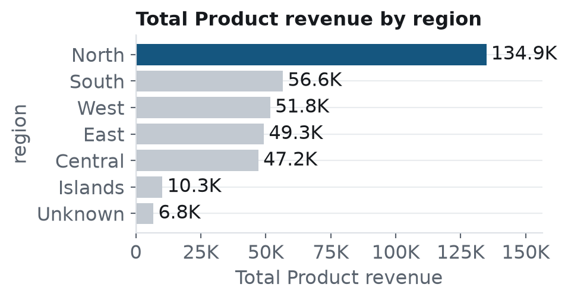

*How to read this: Bars show total product revenue by region; tallest bar indicates top‑earning region*

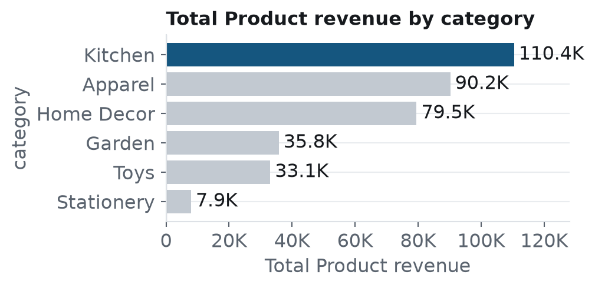

*How to read this: Bars display total product revenue by category; highest bar reveals most profitable category*

Trust: **High**: the figures are computed directly from the data

Details

- Full answer: Top 3 region by total Product revenue: region North 134,884 (37.8%), region South 56,630 (15.9%), region West 51,776 (14.5%). Top 3 category by total Product revenue: category Kitchen 110,425 (30.9%), category Apparel 90,230 (25.3%), category Home Decor 79,506 (22.3%).
- Top 3 region by total Product revenue: region North 134,884 (37.8%), region South 56,630 (15.9%), region West 51,776 (14.5%)
- Top 3 category by total Product revenue: category Kitchen 110,425 (30.9%), category Apparel 90,230 (25.3%), category Home Decor 79,506 (22.3%)
- Top 3 Sales Channel by total Product revenue: sales channel Web Store 195,834 (54.9%), sales channel Marketplace 107,013 (30.0%), sales channel Social Shop 54,117 (15.2%)
- Top 3 Payment Method by total Product revenue: payment method Card 178,016 (49.9%), payment method Wallet 85,080 (23.8%), payment method Cash on Delivery 59,373 (16.6%)
- Top 3 Acquisition Channel by total Product revenue: acquisition channel Search 98,560 (27.6%), acquisition channel Social 79,333 (22.2%), acquisition channel Marketplace 73,431 (20.6%)

**2. What factors differentiate orders that are returned from those that are not?**

Top 3 Sales Channel by total Returns Count: sales channel Web Store 258 (52%), sales channel Marketplace 161 (33%), sales channel Social Shop 73 (15%)  
Biggest change in Returns Count by Sales Channel, 2024 vs 2025: sales channel Web Store +84% (91 to 167), statistically reliable  

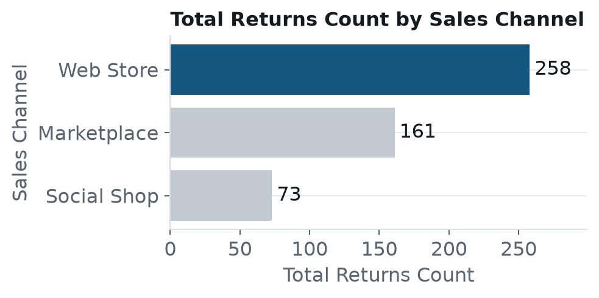

*How to read this: Bars illustrate return counts per sales channel; larger bars signal higher return volume*

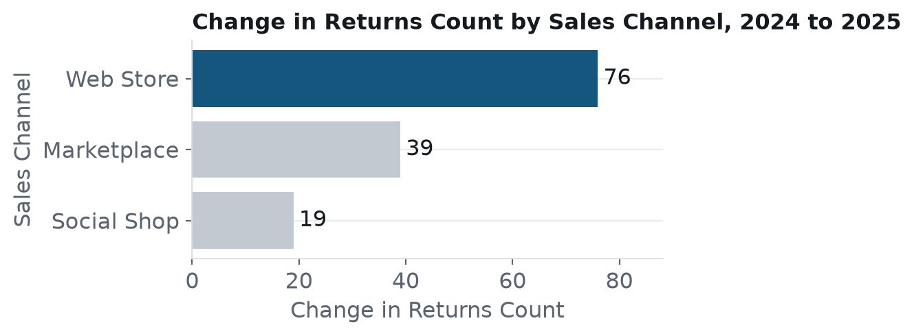

*How to read this: Line shows percent change in return counts 2024‑2025 by channel, highlighting growth differences*

Trust: **High**: the figures are computed directly from the data

Details

- Full answer: By total Returns Count, sales channel Web Store is highest at 258 (52.4% of the total Returns Count, dominant) and sales channel Social Shop is lowest at 73. Growth in total Returns Count by Sales Channel, 2024 vs 2025 (first and last full periods): sales channel Web Store +83.5% (from 91 to 167), statistically reliable; sales channel Marketplace +63.9% (from 61 to 100), statistically reliable; sales channel Social Shop +70.4% (from 27 to 46), not statistically reliable. Reliability is a Welch test on monthly totals, corrected for 3 groups.
- Top 3 Sales Channel by total Returns Count: sales channel Web Store 258 (52.4%), sales channel Marketplace 161 (32.7%), sales channel Social Shop 73 (14.8%)
- Growth in total Returns Count by Sales Channel, 2024 vs 2025 (first and last full periods): sales channel Web Store +83.5% (from 91 to 167), statistically reliable; sales channel Marketplace +63.9% (from 61 to 100), statistically reliable; sales channel Social Shop +70.4% (from 27 to 46), not statistically reliable. Reliability is a Welch test on monthly totals, corrected for 3 groups.

**3. How does revenue evolve over time and are there seasonal patterns?**

Biggest change in Product revenue by Sales Channel, 2024 vs 2025: sales channel Web Store +72% (72K to 123.8K), statistically reliable  
Unit price to unit cost ratio by Sales Channel: highest sales channel Social Shop 200.0%, lowest sales channel Marketplace 198.9% (overall 199.6%)  

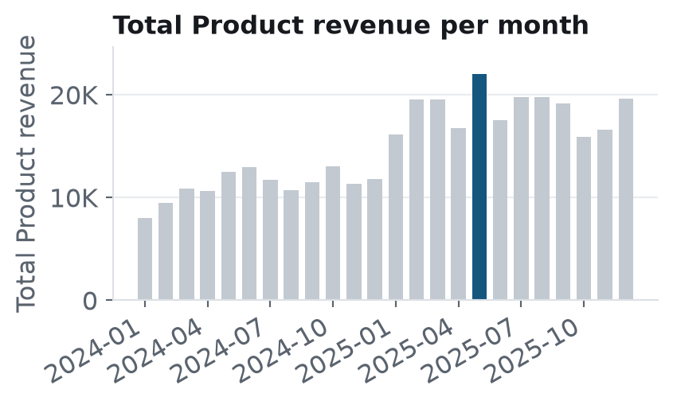

*How to read this: Series plots monthly total product revenue, revealing overall trend and seasonal peaks*

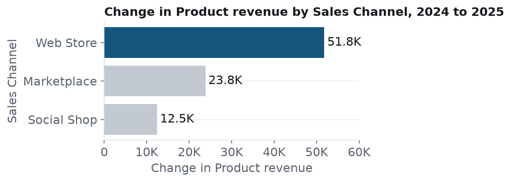

*How to read this: Bars compare revenue change 2024‑2025 by sales channel, showing which channels grew most*

Trust: **Low**: the seasonality result could be random variation

Details

- Full answer: Product revenue (sum per month) shows a statistically significant upward trend. Best month: 2025-05-01 (22.0K); weakest: 2024-01-01 (8,034). The first and last months may be partial. Product revenue does not vary reliably by day of the week. Highest: Tue (536); lowest: Sun (485); overall 499. Values are the average daily total, not a per-row average. By month of the year, Product revenue does not vary reliably: highest May (17.2K), lowest Jan (12.1K).
- Product revenue is trending up (+75% over the period) (Medium confidence. Based on 24 monthly data points (5,846 rows).)
- No reliable weekday pattern in Product revenue (Low confidence. The result is not statistically significant, so it could be random variation.)
- Growth in total Product revenue by Sales Channel, 2024 vs 2025 (first and last full periods): sales channel Web Store +71.9% (from 72,015 to 123,819), statistically reliable; sales channel Marketplace +57.3% (from 41,599 to 65,414), statistically reliable; sales channel Social Shop +59.8% (from 20,829 to 33,288), statistically reliable. Reliability is a Welch test on monthly totals, corrected for 3 groups.
- By Unit price to unit cost ratio (total Unit Price over total Unit Cost), sales channel Social Shop is highest at 200.0% and sales channel Marketplace is lowest at 198.9%; all together it is 199.6%. Ranked by rate: groups with at least 30 rows. Top by amount (total Unit Price, not by rate): sales channel Web Store 116,886, sales channel Marketplace 65,884, sales channel Social Shop 32,904.

**4. Which segment combinations show unusually high or low revenue?**

Social Shop × Unknown stands out (average 75.2 per record); Marketplace × East is weakest (average 55.4 per record)  
Trust: **Low**: the heatmap figures are leads that were not statistically tested

Details

- Full answer: Social Shop × Unknown stands out (average 75.2 per record); Marketplace × East is weakest (average 55.4 per record).
- Social Shop × Unknown stands out (average 75.2 per record); Marketplace × East is weakest (average 55.4 per record) (Exploratory confidence. Individual cells are not statistically tested; use them as leads to check. Based on 5,846 rows split into 21 cells.)

**Also named in your goal**

- **By Payment Method** (named in your goal). Top 3 Payment Method by total Product revenue: payment method Card 178K (50%), payment method Wallet 85.1K (24%), payment method Cash on Delivery 59.4K (17%)
- **By Acquisition Channel** (named in your goal). Top 3 Acquisition Channel by total Product revenue: acquisition channel Search 98.6K (28%), acquisition channel Social 79.3K (22%), acquisition channel Marketplace 73.4K…
- **By Product Name** (named in your goal). Top 3 Product Name by total Product revenue: product name Compact Scarf 15.2K (4%), product name Modern Hoodie 13.9K (4%), product name Premium Joggers 13.6K (4%)

### What to do

1. Put more behind what works: category = Apparel; category = Home Decor: Grow overall Unit Price by investing where it is strongest (category Apparel) while diagnosing why category Stationery lags. *(question 1)*

   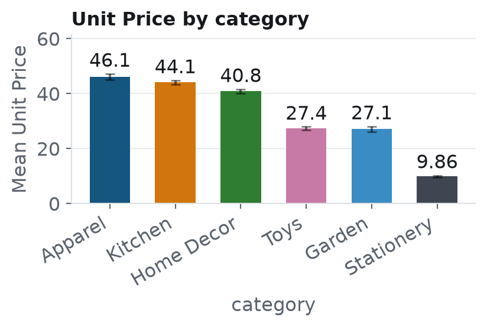

   *Supported by: category = Apparel averages 4.7× the Unit Price of Stationery (average 46.1 per record vs 9.86 for Stationery) (large effect)*

2. Target cost reduction for Kitchen category: Lower cost per item for Kitchen by focusing improvement efforts there rather than across all categories. *(question 1)*

   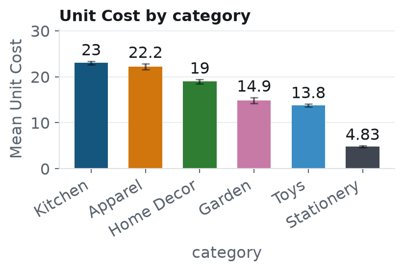

   *Supported by: category = Kitchen averages 4.8× the Unit Cost of Stationery (average 23 per record vs 4.83 for Stationery) (large effect)*

3. Launch a pricing optimization test in the Social Shop, which has the highest unit price to unit cost ratio at 200.0% unit price to unit cost ratio and achieved a 59.8% product revenue growth (2024 vs 2025) from 20,829 to 33,288 product revenue. *(question 3)*

   

   *Supported by: Biggest change in Product revenue by Sales Channel, 2024 vs 2025: sales channel Web Store +72% (72K to 123.8K), statistically reliable*

- No action suggested for question 2: the data supports no specific change for it.
- No action suggested for question 4: the data shows no medium or larger effect to act on.

## Key numbers

| Total Product revenue | Orders | Total quantity | Total Shipping Fee | Period covered | Rows |
|---|---|---|---|---|---|
| **356,964** | **3,300** | **9,720** | **17,219** | **01 Jan 2024 – 31 Dec 2025** | **5,886** |

---

**View more**

Answer details: exact figures, facts and statistics

**1. Which channels, regions, or product categories generate the most revenue?**

- Answer: Top 3 region by total Product revenue: region North 134,884 (37.8%), region South 56,630 (15.9%), region West 51,776 (14.5%). Top 3 category by total Product revenue: category Kitchen 110,425 (30.9%), category Apparel 90,230 (25.3%), category Home Decor 79,506 (22.3%).
- r28: By total Product revenue, region North is highest at 134,884 (37.8% of the total Product revenue) and region Unknown is lowest at 6,834.
- r55: By total Product revenue, category Kitchen is highest at 110,425 (30.9% of the total Product revenue) and category Stationery is lowest at 7,937.

**2. What factors differentiate orders that are returned from those that are not?**

- Answer: By total Returns Count, sales channel Web Store is highest at 258 (52.4% of the total Returns Count, dominant) and sales channel Social Shop is lowest at 73. Growth in total Returns Count by Sales Channel, 2024 vs 2025 (first and last full periods): sales channel Web Store +83.5% (from 91 to 167), statistically reliable; sales channel Marketplace +63.9% (from 61 to 100), statistically reliable; sales channel Social Shop +70.4% (from 27 to 46), not statistically reliable. Reliability is a Welch test on monthly totals, corrected for 3 groups.
- r8: By total Returns Count, sales channel Web Store is highest at 258 (52.4% of the total Returns Count, dominant) and sales channel Social Shop is lowest at 73.
- r9: Growth in total Returns Count by Sales Channel, 2024 vs 2025 (first and last full periods): sales channel Web Store +83.5% (from 91 to 167), statistically reliable; sales channel Marketplace +63.9% (from 61 to 100), statistically reliable; sales channel Social Shop +70.4% (from 27 to 46), not statistically reliable. Reliability is a Welch test on monthly totals, corrected for 3 groups.

**3. How does revenue evolve over time and are there seasonal patterns?**

- Answer: Product revenue (sum per month) shows a statistically significant upward trend (about +75% across the period, p<0.001). Best month: 2025-05-01 (22.0K); weakest: 2024-01-01 (8,034). The first and last months may be partial. Product revenue does not vary reliably by day of the week (ANOVA on period totals p=1, effect size eta²=0.003). Highest: Tue (536); lowest: Sun (485); overall 499. Values are the average daily total, not a per-row average. By month of the year, Product revenue does not vary reliably (p=1, eta²=0.093): highest May (17.2K), lowest Jan (12.1K).
- f9: Product revenue is trending up (+75% over the period) · confidence: Medium · p<0.001 · Based on 24 monthly data points (5,846 rows).
- f10: No reliable weekday pattern in Product revenue · confidence: Low · p=1.00 · effect: negligible · The result is not statistically significant, so it could be random variation.

**4. Which segment combinations show unusually high or low revenue?**

- Answer: Social Shop × Unknown stands out (average 75.2 per record); Marketplace × East is weakest (average 55.4 per record).
- f12: Social Shop × Unknown stands out (average 75.2 per record); Marketplace × East is weakest (average 55.4 per record) · confidence: Exploratory · Individual cells are not statistically tested; use them as leads to check. Based on 5,846 rows split into 21 cells.

**Headline findings**

- By total Product revenue, region North is highest at 134,884 (37.8% of the total Product revenue) and region Unknown is lowest at 6,834 (r28)
- By total Product revenue, category Kitchen is highest at 110,425 (30.9% of the total Product revenue) and category Stationery is lowest at 7,937 (r55)
- By total Returns Count, sales channel Web Store is highest at 258 (52.4% of the total Returns Count, dominant) and sales channel Social Shop is lowest at 73. Same leader for Product revenue at 195,834 (54.9%); quantity at 5,282 (54.3%); Shipping Fee at 9,250 (53.7%); Return Refund Total at 16,841 (51.0%); Return Reason Flag at 250 (52.4%) (r8)
- Growth in total Returns Count by Sales Channel, 2024 vs 2025 (first and last full periods): sales channel Web Store +83.5% (from 91 to 167), statistically reliable; sales channel Marketplace +63.9% (from 61 to 100), statistically reliable; sales channel Social Shop +70.4% (from 27 to 46), not statistically reliable. Reliability is a Welch test on monthly totals, corrected for 3 groups (r9)
- Product revenue is trending up (+75% over the period) (f9)

**Written summary**

Unit price to unit cost ratio does not reliably differ across region.

**Also named in your goal**
- **By Payment Method** (named in your goal). Top 3 Payment Method by total Product revenue: payment method Card 178,016 (49.9%), payment method Wallet 85,080 (23.8%), payment method Cash on Delivery 59,373 (16.6%)
- **By Acquisition Channel** (named in your goal). Top 3 Acquisition Channel by total Product revenue: acquisition channel Search 98,560 (27.6%), acquisition channel Social 79,333 (22.2%), acquisition channel Marketplace 73,431 (20.6%)
- **By Product Name** (named in your goal). Top 3 Product Name by total Product revenue: product name Compact Scarf 15,219 (4.3%), product name Modern Hoodie 13,916 (3.9%), product name Premium Joggers 13,609 (3.8%)

**Goal:** Find what drives revenue and returns, and what to do about it.

The dataset has 5,886 rows and 24 columns. The agents focused on **Product revenue**. 34 analyses were run and 23 of them were tested for significance. 6 showed statistically significant patterns; 5 remain significant after correcting for 19 comparisons.

Evidence (3 findings)

The 3 findings that matter most: named by your goal, or still significant after correction with a medium or larger effect. Ordered by importance.

### category = Apparel averages 4.7× the Unit Price of Stationery (average 46.1 per record vs 9.86 for Stationery) (large effect) ✅

*Unit Price by category* · confidence: **High** · f25, f19

**What we see.** Average **Unit Price** is highest for **category = Apparel** (46.1) and lowest for **Stationery** (9.86). The difference is statistically significant (ANOVA p<0.001, eta²=0.358, large effect).

**Why it matters.** Apparel is where Unit Price is strongest and Stationery where it is weakest. That points to putting more promotions and bundles behind what already works, and finding out what is holding Stationery back.

**How much to trust it.** Still significant after correcting for the number of comparisons made. Large effect size, so the difference is big enough to matter. Based on 5,886 rows.

**Same split, Unit price to unit cost ratio.** category = Home Decor averages 1.2× the Unit price to unit cost ratio of Garden (overall 2.12 vs 1.84 for Garden, total over total) (medium effect). **Unit price to unit cost ratio** (total Unit Price over total Unit Cost) is highest for **category = Home Decor** (2.12) and lowest for **Garden** (1.84). The difference is statistically significant (permutation test on the ratio of sums p<0.001, eta²=0.077, medium effect).

**Possible explanations to test (not conclusions):**
- category Apparel may differ in mix, for example in `quantity`, `Unit Price` or `Shipping Fee`
- Another column could be driving both category and Unit Price (a confounder)

**Check next:**
- Check whether the Apparel vs Stationery gap holds inside other splits (e.g. region, product) before acting
- Pilot any change on part of the group, with the rest as a control

### category = Kitchen averages 4.8× the Unit Cost of Stationery (average 23 per record vs 4.83 for Stationery) (large effect) ✅

*Unit Cost by category* · confidence: **High** · f31

**What we see.** Average **Unit Cost** is highest for **category = Kitchen** (23) and lowest for **Stationery** (4.83). The difference is statistically significant (ANOVA p<0.001, eta²=0.321, large effect).

**Why it matters.** Unit Cost is not spread evenly: the problem is concentrated in category Kitchen, so a one-size-fits-all programme would spend effort where it is not needed. Starting with category Kitchen gives the best chance of moving the overall number.

**How much to trust it.** Still significant after correcting for the number of comparisons made. Large effect size, so the difference is big enough to matter. Based on 5,637 rows.

**Possible explanations to test (not conclusions):**
- category Kitchen may differ in mix, for example in `quantity`, `Unit Price` or `Shipping Fee`
- Another column could be driving both category and Unit Cost (a confounder)

**Check next:**
- Check whether the Kitchen vs Stationery gap holds inside other splits (e.g. region, product) before acting
- Pilot any change on part of the group, with the rest as a control

### category = Apparel averages 4.7× the Product revenue of Stationery (average 77.3 per record vs 16.3 for Stationery) (large effect) ✅

*Product revenue by category* · confidence: **High** · f32, f7

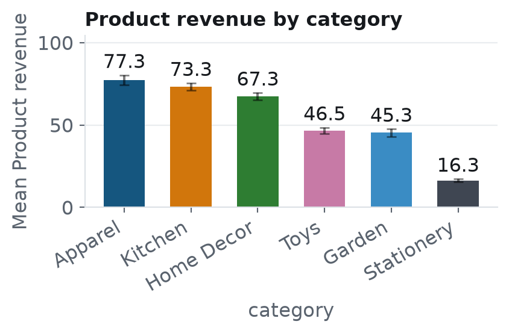

**What we see.** Average **Product revenue** is highest for **category = Apparel** (77.3) and lowest for **Stationery** (16.3). The difference is statistically significant (ANOVA p<0.001, eta²=0.177, large effect).

**Why it matters.** Apparel is where Product revenue is strongest and Stationery where it is weakest. That points to putting more promotions and bundles behind what already works, and finding out what is holding Stationery back.

**How much to trust it.** Still significant after correcting for the number of comparisons made. Large effect size, so the difference is big enough to matter. Based on 5,846 rows.

- Median check (Kruskal-Wallis): the difference holds, p<0.001.

**Possible explanations to test (not conclusions):**
- category Apparel may differ in mix, for example in `quantity`, `Unit Price` or `Shipping Fee`
- Another column could be driving both category and Product revenue (a confounder)

**Check next:**
- Check whether the Apparel vs Stationery gap holds inside other splits (e.g. region, product) before acting
- Pilot any change on part of the group, with the rest as a control

Growth in Product revenue by Sales Channel, 2024 vs 2025

- sales channel Web Store +71.9% (from 72,015 to 123,819), statistically reliable
- sales channel Marketplace +57.3% (from 41,599 to 65,414), statistically reliable
- sales channel Social Shop +59.8% (from 20,829 to 33,288), statistically reliable

Growth in Product revenue by Payment Method, 2024 vs 2025

- payment method Card +76.5% (from 64,375 to 113,640), statistically reliable
- payment method Wallet +60.7% (from 32,635 to 52,446), statistically reliable
- payment method Cash on Delivery +34.5% (from 25,316 to 34,057)
- payment method Bank Transfer +74.1% (from 11,412 to 19,865), statistically reliable
- payment method Unknown +1,810 (from 704 to 2,514), statistically reliable

*Lines without 'statistically reliable' are not statistically reliable (Welch test on sub-period totals, corrected for the number of groups).*

Growth in Product revenue by region, 2024 vs 2025

- region North +51.7% (from 53,587 to 81,297), statistically reliable
- region West +100.9% (from 17,209 to 34,567), statistically reliable
- region Central +83.0% (from 16,688 to 30,532), statistically reliable
- region South +57.0% (from 22,037 to 34,593), statistically reliable
- region East +60.1% (from 18,975 to 30,373), statistically reliable
- region Islands +75.1% (from 3,734 to 6,539)
- region Unknown +108.7% (from 2,214 to 4,621)

*Lines without 'statistically reliable' are not statistically reliable (Welch test on sub-period totals, corrected for the number of groups).*

Growth in Product revenue by Acquisition Channel, 2024 vs 2025

- acquisition channel Search +73.0% (from 36,107 to 62,453), statistically reliable
- acquisition channel Social +57.6% (from 30,800 to 48,533), statistically reliable
- acquisition channel Marketplace +58.4% (from 28,418 to 45,013), statistically reliable
- acquisition channel Email +85.7% (from 17,517 to 32,526), statistically reliable
- acquisition channel Referral +42.3% (from 15,403 to 21,924), statistically reliable
- acquisition channel Unknown +94.8% (from 6,198 to 12,072)

*Lines without 'statistically reliable' are not statistically reliable (Welch test on sub-period totals, corrected for the number of groups).*

Growth in Product revenue by category, 2024 vs 2025

- category Kitchen +74.3% (from 40,259 to 70,166), statistically reliable
- category Home Decor +78.9% (from 28,504 to 51,002), statistically reliable
- category Apparel +47.3% (from 36,490 to 53,740), statistically reliable
- category Toys +64.3% (from 12,512 to 20,559), statistically reliable
- category Garden +56.6% (from 13,949 to 21,847), statistically reliable
- category Stationery +90.9% (from 2,728 to 5,209), statistically reliable

Product revenue by other categories

- By total Product revenue across 70 Item Code groups, the top 5 are item code SKU-0029 11,670 (3.3%), item code SKU-0009 11,026 (3.1%), item code SKU-0005 10,442 (2.9%), item code SKU-0013 10,275 (2.9%), item code SKU-0003 9,901 (2.8%); the other 65 groups hold 303,650 (85.1%), and item code SKU-0066 is lowest at 411.
- By total Product revenue across 62 Product Name groups, the top 5 are product name Compact Scarf 15,219 (4.3%), product name Modern Hoodie 13,916 (3.9%), product name Premium Joggers 13,609 (3.8%), product name Everyday Cap 13,242 (3.7%), product name Starter Socks Pack 11,155 (3.1%); the other 57 groups hold 289,822 (81.2%), and product name Deluxe Sticker Pack is lowest at 411.

Checked, nothing found (17)

Checked, nothing found: tested and not statistically significant, so no reliable pattern.

- Product revenue does not differ reliably across Sales Channel (p=0.13) (f4)
- Product revenue does not differ reliably across region (p=0.72) (f6)
- No reliable weekday pattern in Product revenue (p=1.00) (f10)
- The Returns Count rate does not differ reliably across Sales Channel (p=0.61) (f11)
- No reliable trend in Unit price to unit cost ratio over time (p=0.24) (f14)
- Unit price to unit cost ratio does not differ reliably across Sales Channel (p=0.65) (f15)
- Unit price to unit cost ratio does not differ reliably across Payment Method (p=0.068) (f17)
- Unit price to unit cost ratio does not differ reliably across region (p=0.47) (f18)
- No reliable trend in Unit Price over time (p=0.22) (f20)
- Unit Price does not differ reliably across Sales Channel (p=0.67) (f21)
- Unit Price does not differ reliably across Payment Method (p=0.21) (f23)
- Unit Price does not differ reliably across region (p=0.49) (f24)
- No reliable trend in Unit Cost over time (p=0.34) (f26)
- Unit Cost does not differ reliably across Sales Channel (p=0.76) (f27)
- Unit Cost does not differ reliably across Payment Method (p=0.085) (f29)
- Unit Cost does not differ reliably across region (p=0.57) (f30)
- No reliable weekday pattern in Unit price to unit cost ratio (p=1.00) (f33)

Strategy and Recommendations

**Top recommendations**

1. Put more behind what works: category = Apparel; category = Home Decor: Grow overall Unit Price by investing where it is strongest (category Apparel) while diagnosing why category Stationery lags. *(question 1)*
2. Target cost reduction for Kitchen category: Lower cost per item for Kitchen by focusing improvement efforts there rather than across all categories. *(question 1)*
3. Launch a pricing optimization test in the Social Shop, which has the highest unit price to unit cost ratio at 200.0% unit price to unit cost ratio and achieved a 59.8% product revenue growth (2024 vs 2025) from 20,829 to 33,288 product revenue. *(question 3)*

3 data-backed strategies (merged from 4 candidates of the same kind), ranked by expected impact, confidence and effort. Each is a hypothesis to test with a small pilot first: the analysis shows association, not cause.

### 1. Put more behind what works: category = Apparel; category = Home Decor

*Data-backed · impact: **High** · effort: **Medium** · timeline: **Next quarter (30-90 days)** · confidence: **High** · based on f25, f19*

**Objective.** Grow overall Unit Price by investing where it is strongest (category Apparel) while diagnosing why category Stationery lags.

**Actions**
1. Direct more promotions and bundles to category Apparel and track Unit Price for it.
2. Find out why category Stationery lags: compare it with category Apparel on `quantity`, `Unit Price` or `Shipping Fee`.
3. Decide whether to lift category Stationery or deliberately shift resources toward category Apparel.

**How to test it first.** Pilot the extra investment on part of Apparel (or a comparable subset) for 4-8 weeks with a hold-out group, and compare Unit Price between them.

**KPIs to track:** Unit Price for Apparel and for Stationery; Pilot vs hold-out difference

**Risks**
- category Apparel may already be near its ceiling, so extra spend could show diminishing returns.
- The gap may partly reflect differences in mix rather than the group itself.

### 2. Target cost reduction for Kitchen category

*Data-backed · impact: **High** · effort: **Medium** · timeline: **Next quarter (30-90 days)** · confidence: **High** · based on f31*

**Objective.** Lower cost per item for Kitchen by focusing improvement efforts there rather than across all categories.

**Actions**
1. Benchmark Kitchen against Stationery on quantity sold, average selling price, and shipping fees to pinpoint cost drivers.
2. Implement a cost‑reduction initiative for Kitchen items, using Stationery as a reference group.
3. Establish a baseline cost per item for Kitchen, set a target reduction, and assign ownership.

**How to test it first.** Conduct a controlled experiment where half of Kitchen SKUs receive the cost‑reduction measures and the other half serve as control; evaluate cost per item after the experiment.

**KPIs to track:** Cost per item for Kitchen; Gap between Kitchen and Stationery; Test vs control difference

**Risks**
- The cost gap may stem from other differences between the categories, not the category itself.
- Focusing on Kitchen could divert attention from other categories; monitor them continuously.

### 3. Diagnose and sustain product revenue growth

*Data-backed · impact: **High** · effort: **Low** · timeline: **Quick win (0-30 days)** · confidence: **Medium** · based on f9*

**Objective.** Identify drivers of the recent rise in product revenue and determine appropriate follow‑up actions.

**Actions**
1. Pinpoint the start of the revenue increase and list any concurrent business or data‑recording changes.
2. Decompose the revenue trend by store segment to locate the primary contributors.
3. Formulate a plan to reinforce successful drivers and define measurement criteria.

**How to test it first.** Compare revenue before and after the identified change point and contrast with the same calendar periods in prior years to rule out seasonality.

**KPIs to track:** Monthly product revenue; Segment contribution to revenue change

**Risks**
- The first and last periods may be incomplete.
- Seasonality can mimic a trend.

**Foundations**

- Close the most important data gaps: Close these gaps from this run: The AI flagged quantity as a number that may be a category; The AI flagged Shipping Fee as a number that may be a category.
- Make this repeatable: track the main KPI in Power BI: Turn a one-off analysis into a regular review so changes are seen early.

How the data was set up (business, sources, cleaning)

**AI usage so far:** 11 call(s) sent, 2 answered from saved or repeated results; about 18,311 input and 15,925 output tokens (estimated); 48.6 s in AI calls. Per stage and per call: ai_usage.json. Biggest stages: llm summary (10,436), propose (6,711), refine with llm (4,282).

**Data concerns:** proposed by the AI, verified by code (5 accepted, 0 not applied).

### About the business (as you described it)

- **Company:** Sample Store
- **Industry lens used:** retail
- **Audience:** you (the business owner) (default: you did not name another audience)
- This context steers what is analysed and how it is worded. It is not verified against the data.

### What we set out to answer

**Objective:** Identify drivers of product revenue and returns, and recommend actions

- Which channels, regions, or product categories generate the most revenue?
- What factors differentiate orders that are returned from those that are not?
- How does revenue evolve over time and are there seasonal patterns?
- Which segment combinations show unusually high or low revenue?

### Data sources and how they were connected

5 tables were uploaded: **customers** (1,400 rows), **order_lines** (5,904 rows), **orders** (3,309 rows), **products** (70 rows), **returns** (492 rows).
The analysis uses **one row per `order_lines` row** (it is the finest-grain table (it references 2 other table(s); parents are joined onto it, nothing is aggregated away)).

- ✅ `order_lines.Order ID` → `orders.Order ID` (many-to-one, 100% of rows match): 100% of rows matched
- ✅ `returns.Line ID` → `order_lines.Line ID` (one-to-one, 100% of rows match): aggregated to one row per order_lines.Line ID; 8% of rows have related records
- ✅ `orders.Customer Ref` → `customers.customer_id` (many-to-one, 100% of rows match): 100% of rows matched
- ✅ `order_lines.Item Code` → `products.sku` (many-to-one, 100% of rows match): 100% of rows matched

- Added 5 columns from orders using order_lines.Order ID → orders.Order ID (100% of rows matched)
- Added 3 columns from customers using orders.Customer Ref → customers.customer_id (100% of rows matched)
- Added 4 columns from products using order_lines.Item Code → products.sku (100% of rows matched)
- Summarised returns (492 rows) to one row per order_lines.Line ID → 5 new columns (Returns Count, Return Refund Total, Return Refund Avg, Days Since Return, Return Reason Flag); 8% of order_lines rows have at least one returns record

### Data and cleaning

5,886 rows × 24 columns. Columns used: `Product revenue`, `quantity`, `Unit Price`, `Shipping Fee`, `Unit Cost`, `List Price`, `Return Refund Total`, `Return Refund Avg`, `Days Since Return`, `Unit price to unit cost ratio`, `Returns Count`, `Sales Channel`, `Payment Method`, `region`, `Acquisition Channel`, `category`, `Order Date`, `Product Name`, `Signup Date`, `Return Reason Flag`.

- **[customers] Convert to date**: 'Signup Date' parsed as dates, order inferred as ISO / year-first. Each value was parsed on its own, so mixed formats are handled. Range: 01 Oct 2023 to 06 Dec 2025.
- **[order_lines] Remove duplicates**: Dropped 18 exact duplicate rows
- **[orders] Convert to date**: 'Order Date' parsed as dates, order inferred as day-first (dd/mm/yyyy). Each value was parsed on its own, so mixed formats are handled. Range: 01 Jan 2024 to 31 Dec 2025.
- **[orders] Remove duplicates**: Dropped 9 exact duplicate rows
- **[returns] Convert to date**: 'return_date' parsed as dates, order inferred as ISO / year-first. Each value was parsed on its own, so mixed formats are handled. Range: 15 Jan 2024 to 26 Jan 2026.
- **Placeholder values**: [orders] treated 1,141 values of 0 in Shipping Fee as missing (default); far below the rest of the column; set to missing before the tables were joined
- **Definition applied**: Created 'Product revenue' = quantity x Unit Price (product). A row with either number blank gets no value and is not counted.
- **Derived ratio**: Created 'Unit price to unit cost ratio' = Unit Price / Unit Cost for 5,637 rows; overall ratio of sums 2.089. Meaning: Shows the gross margin per unit; higher values indicate more profit per sale. (both measures are also analysed on their own; groups are always summed first, then divided)
- **Derived measure rejected**: Return Refund Avg / Unit Price was not created: Return Refund Avg / Unit Price gives the same values as the column quantity, so it adds nothing new
- **Scope to the goal**: Columns not needed for this goal were left untouched and excluded from analysis: Line ID, Order ID, Item Code, Customer Ref
- **Missing target values**: 'Product revenue' is the target; 0.7% missing rows were NOT imputed and are ignored in calculations
- **Blanks left blank**: 40 blank values in quantity left blank, not counted in totals
- **Blanks left blank**: 2,040 blank values in Shipping Fee left blank, not counted in totals
- **Blanks left blank**: 249 blank values in Unit Cost left blank, not counted in totals
- **Too much missing**: 'Return Refund Avg' is 92% missing; left as-is (not imputed) and used with caution
- **Too much missing**: 'Days Since Return' is 92% missing; left as-is (not imputed) and used with caution
- **Impute numeric**: 'Unit price to unit cost ratio': 249 blank values (4.2%) filled with the median (1.992)
- **Impute category**: 'Payment Method': 0.8% missing labelled 'Unknown'
- **Impute category**: 'region': 1.8% missing labelled 'Unknown'
- **Impute category**: 'Acquisition Channel': 5.4% missing labelled 'Unknown'
- **Missing dates**: 'Signup Date': 0.4% rows have no date and are skipped in time-trend analysis
- **Flag outliers**: 'Product revenue': 199 values (3.4%) outside 1.5×IQR. Flagged, NOT removed - they may be real
- **Flag outliers**: 'Unit Cost': 79 values (1.4%) outside 1.5×IQR. Flagged, NOT removed - they may be real
- **Flag outliers**: 'Return Refund Avg': 23 values (4.7%) outside 1.5×IQR. Flagged, NOT removed - they may be real

### What each column is (the data understanding record)

- **measure**: `quantity`, `Shipping Fee`, `Unit Cost`, `List Price`, `Unit Price`, `Return Refund Total`, `Return Refund Avg`, `Days Since Return`
- **category**: `Item Code`, `Sales Channel`, `Payment Method`, `region`, `Acquisition Channel`, `Product Name`, `category`
- **date**: `Order Date`, `Signup Date`
- **id**: `Line ID`, `Order ID`
- **flag**: `Returns Count`, `Return Reason Flag`
- **free_text**: `Customer Ref`
- **Odd but expected**: `Shipping Fee`: Many missing values expected for orders with free shipping; `Unit Cost`: Some missing values are normal for items without recorded cost; `Return Refund Avg`: Missing for non‑returned lines, which is expected; `Days Since Return`: Missing for non‑returned lines, which is expected
- **Your goal's words**: “revenue” → `quantity`, `Unit Price`, `List Price`, `Shipping Fee`, `Unit Cost`, `Sales Channel`, `Payment Method`, `region`, `Acquisition Channel`, `Product Name`, `category`, `Order Date`, `Signup Date`; “returns” → `Returns Count`, `Return Refund Total`, `Return Refund Avg`, `Return Reason Flag`, `Days Since Return`, `Sales Channel`, `Payment Method`, `region`, `Acquisition Channel`, `Product Name`, `category`, `Order Date`, `Signup Date`
- Reused saved AI result: relations.llm_review, critic.review.

Definitions used

**Derived metrics** (new columns the analysis created; each is a ratio of sums, never an average of row ratios; remove one with the Remove button in the app and the analysis re-runs without it):

- `Unit price to unit cost ratio` = Unit Price / Unit Cost: Shows the gross margin per unit; higher values indicate more profit per sale.
- Not created: Return Refund Avg / Unit Price: Return Refund Avg / Unit Price gives the same values as the column quantity, so it adds nothing new

| Question | Answer | Set by | Effect on the data | Rows affected |
|---|---|---|---|---|
| How should the value 0 in Shipping Fee be treated? | As missing (default) | Default (rules) | 1,141 values of 0 in Shipping Fee were set to missing before the tables were joined. | 1,141 |
| Which date column should be used as the primary date for analysis? | Order Date | Default (AI-suggested) | Time analysis uses 'Order Date' (5,886 rows have a value). | 5,886 |
| 492 rows (8%) are flagged '1.0' in Returns Count. If they are reversed or voided rows, should they be taken out of the totals (net) or counted as they are (gross)? | Gross: count every row | Default (rules) | Recorded as context; the data was not changed. | - |
| Revenue is quantity x Unit Price | Unit Price is the price of one unit: revenue = quantity x Unit Price | data | Created 'Product revenue' = quantity x Unit Price for 5,846 rows. A row with either number blank gets no value and is not counted. | 5,846 |

Statistics and limitations

**Data gaps and what would sharpen this**

- **The AI flagged quantity as a number that may be a category.** Only three distinct values, likely categorical quantity levels *No automatic fix exists for this yet; check the column before relying on it.*
- **The AI flagged Shipping Fee as a number that may be a category.** Only three distinct shipping fees, may represent tiered categories rather than continuous cost *No automatic fix exists for this yet; check the column before relying on it.*
- **The AI flagged Acquisition Channel.** 315 missing values could bias analysis of channel impact on revenue *No automatic fix exists for this yet; check the column before relying on it.*
- **The AI flagged Shipping Fee.** 2040 missing Shipping Fee entries may affect cost and profit calculations *No automatic fix exists for this yet; check the column before relying on it.*
- **The AI flagged Return Refund Avg.** Missing in 5394 rows; only returns have values, limiting return‑related insights *No automatic fix exists for this yet; check the column before relying on it.*

**Reliability and limitations**

- ⚠️ 'Product revenue by Payment Method' was significant on its own (p=0.0296) but not after correcting for 19 comparisons (adjusted p=0.562); treat it as a lead, not a result.
- 'Product revenue by Payment Method' is statistically detectable but the effect is small (eta_squared=0.002), so it may not matter in practice; no action is recommended from it alone.
- 19 comparisons were run; Bonferroni-adjusted p-values are shown to limit false positives.
- 'Product revenue by category' also holds with a median-based test (robust).
- ⚠️ 'Product revenue by Payment Method' is significant by mean but not by median-based test: the effect may be driven by outliers.
- Statistically significant Payment Method effect has negligible practical size
- Sales Channel revenue differences are non‑significant yet highlighted
- Category revenue differences may reflect price or volume confounding
- Top‑category revenue share may be driven by sales volume, not higher per‑unit value
- These are statistical associations in observational data; they do not prove cause and effect. Strategies are hypotheses to test.

**All key numbers**

- **Total Product revenue:** 356,964
- **Total quantity:** 9,720
- **Total Shipping Fee:** 17,219
- **Total Returns Count:** 492
- **Total Return Refund Total:** 33,000
- **Total Return Reason Flag:** 477
- **Unit price to unit cost ratio (total Unit Price over total Unit Cost):** 199.6%
- **Gross profit:** 4,962 (Return Refund Total minus Shipping Fee)
- **Gross margin:** 22.4% (gross profit divided by Return Refund Total)
- **Period covered:** 01 Jan 2024 – 31 Dec 2025 (730 days)

Appendix

Growth in quantity by Sales Channel, 2024 vs 2025

- sales channel Web Store +74.4% (from 1,925 to 3,357), statistically reliable
- sales channel Marketplace +57.4% (from 1,145 to 1,802), statistically reliable
- sales channel Social Shop +61.6% (from 570 to 921), statistically reliable

Growth in Shipping Fee by Sales Channel, 2024 vs 2025

- sales channel Web Store +63.4% (from 3,511 to 5,738), statistically reliable
- sales channel Marketplace +52.7% (from 2,111 to 3,223), statistically reliable
- sales channel Social Shop +52.1% (from 1,045 to 1,590), statistically reliable

Growth in Returns Count by Sales Channel, 2024 vs 2025

- sales channel Web Store +83.5% (from 91 to 167), statistically reliable
- sales channel Marketplace +63.9% (from 61 to 100), statistically reliable
- sales channel Social Shop +70.4% (from 27 to 46)

*Lines without 'statistically reliable' are not statistically reliable (Welch test on sub-period totals, corrected for the number of groups).*

Growth in Return Refund Total by Sales Channel, 2024 vs 2025

- sales channel Web Store +83.0% (from 5,950 to 10,891), statistically reliable
- sales channel Marketplace +47.5% (from 4,219 to 6,225)
- sales channel Social Shop +78.2% (from 2,055 to 3,662)

*Lines without 'statistically reliable' are not statistically reliable (Welch test on sub-period totals, corrected for the number of groups).*

Growth in Return Reason Flag by Sales Channel, 2024 vs 2025

- sales channel Web Store +84.1% (from 88 to 162), statistically reliable
- sales channel Marketplace +66.1% (from 59 to 98), statistically reliable
- sales channel Social Shop +80.0% (from 25 to 45)

*Lines without 'statistically reliable' are not statistically reliable (Welch test on sub-period totals, corrected for the number of groups).*

Growth in quantity by Payment Method, 2024 vs 2025

- payment method Card +76.1% (from 1,762 to 3,103), statistically reliable
- payment method Wallet +67.3% (from 871 to 1,457), statistically reliable
- payment method Cash on Delivery +38.6% (from 651 to 902), statistically reliable
- payment method Bank Transfer +63.7% (from 336 to 550), statistically reliable
- payment method Unknown +48 (from 20 to 68)

*Lines without 'statistically reliable' are not statistically reliable (Welch test on sub-period totals, corrected for the number of groups).*

Growth in Shipping Fee by Payment Method, 2024 vs 2025

- payment method Card +64.9% (from 3,322 to 5,476), statistically reliable
- payment method Wallet +65.4% (from 1,565 to 2,588), statistically reliable
- payment method Cash on Delivery +52.2% (from 1,057 to 1,609), statistically reliable
- payment method Bank Transfer +17.3% (from 671 to 788)
- payment method Unknown +38 (from 52.7 to 90.7)

*Lines without 'statistically reliable' are not statistically reliable (Welch test on sub-period totals, corrected for the number of groups).*

Growth in Returns Count by Payment Method, 2024 vs 2025

- payment method Card +75.6% (from 82 to 144), statistically reliable
- payment method Wallet +143.9% (from 41 to 100), statistically reliable
- payment method Bank Transfer +23.8% (from 21 to 26)
- payment method Cash on Delivery +15.6% (from 32 to 37)
- payment method Unknown +3 (from 3 to 6)

*Lines without 'statistically reliable' are not statistically reliable (Welch test on sub-period totals, corrected for the number of groups).*

Growth in Return Refund Total by Payment Method, 2024 vs 2025

- payment method Wallet +151.3% (from 2,672 to 6,715), statistically reliable
- payment method Card +68.1% (from 5,474 to 9,199), statistically reliable
- payment method Unknown +436 (from 129 to 565)
- payment method Bank Transfer +19.5% (from 1,197 to 1,430)
- payment method Cash on Delivery +4.2% (from 2,751 to 2,867)

*Lines without 'statistically reliable' are not statistically reliable (Welch test on sub-period totals, corrected for the number of groups).*

Growth in Return Reason Flag by Payment Method, 2024 vs 2025

- payment method Card +81.8% (from 77 to 140), statistically reliable
- payment method Wallet +141.5% (from 41 to 99), statistically reliable
- payment method Bank Transfer +19.0% (from 21 to 25)
- payment method Cash on Delivery +12.9% (from 31 to 35)
- payment method Unknown +4 (from 2 to 6)

*Lines without 'statistically reliable' are not statistically reliable (Welch test on sub-period totals, corrected for the number of groups).*

Growth in quantity by region, 2024 vs 2025

- region North +50.0% (from 1,465 to 2,198), statistically reliable
- region West +95.5% (from 490 to 958), statistically reliable
- region Central +89.0% (from 444 to 839), statistically reliable
- region South +67.0% (from 576 to 962), statistically reliable
- region East +59.2% (from 517 to 823), statistically reliable
- region Islands +90.4% (from 94 to 179)
- region Unknown +124.1% (from 54 to 121)

*Lines without 'statistically reliable' are not statistically reliable (Welch test on sub-period totals, corrected for the number of groups).*

Growth in Shipping Fee by region, 2024 vs 2025

- region North +42.3% (from 2,736 to 3,893), statistically reliable
- region West +115.8% (from 829 to 1,788), statistically reliable
- region South +53.7% (from 1,025 to 1,575)
- region Central +53.8% (from 928 to 1,428), statistically reliable
- region East +52.8% (from 891 to 1,361), statistically reliable
- region Unknown +151 (from 85.6 to 236)
- region Islands +55.1% (from 173 to 269)

*Lines without 'statistically reliable' are not statistically reliable (Welch test on sub-period totals, corrected for the number of groups).*

Growth in Returns Count by region, 2024 vs 2025

- region North +90.6% (from 64 to 122), statistically reliable
- region West +116.7% (from 24 to 52)
- region East +65.4% (from 26 to 43)
- region South +53.3% (from 30 to 46)
- region Central +51.9% (from 27 to 41)
- region Islands +100.0% (from 3 to 6)
- region Unknown -40.0% (from 5 to 3)

*Lines without 'statistically reliable' are not statistically reliable (Welch test on sub-period totals, corrected for the number of groups).*

Growth in Return Refund Total by region, 2024 vs 2025

- region North +105.7% (from 3,867 to 7,956), statistically reliable
- region West +231.4% (from 1,034 to 3,427), statistically reliable
- region Central +68.9% (from 1,769 to 2,989)
- region East +36.8% (from 2,014 to 2,754)
- region Unknown -62.7% (from 413 to 154)
- region Islands +80.6% (from 303 to 548)
- region South +4.5% (from 2,822 to 2,948)

*Lines without 'statistically reliable' are not statistically reliable (Welch test on sub-period totals, corrected for the number of groups).*

Growth in Return Reason Flag by region, 2024 vs 2025

- region North +89.1% (from 64 to 121), statistically reliable
- region West +117.4% (from 23 to 50)
- region East +70.8% (from 24 to 41)
- region South +60.7% (from 28 to 45)
- region Central +60.0% (from 25 to 40)
- region Islands +66.7% (from 3 to 5)
- region Unknown -40.0% (from 5 to 3)

*Lines without 'statistically reliable' are not statistically reliable (Welch test on sub-period totals, corrected for the number of groups).*

Growth in quantity by Acquisition Channel, 2024 vs 2025

- acquisition channel Search +70.3% (from 993 to 1,691), statistically reliable
- acquisition channel Social +65.2% (from 825 to 1,363), statistically reliable
- acquisition channel Marketplace +64.1% (from 755 to 1,239), statistically reliable
- acquisition channel Email +81.8% (from 484 to 880), statistically reliable
- acquisition channel Referral +41.7% (from 408 to 578), statistically reliable
- acquisition channel Unknown +88.0% (from 175 to 329)

*Lines without 'statistically reliable' are not statistically reliable (Welch test on sub-period totals, corrected for the number of groups).*

Growth in Shipping Fee by Acquisition Channel, 2024 vs 2025

- acquisition channel Search +63.8% (from 1,789 to 2,932), statistically reliable
- acquisition channel Social +58.9% (from 1,504 to 2,389), statistically reliable
- acquisition channel Marketplace +45.9% (from 1,464 to 2,136)
- acquisition channel Email +63.5% (from 949 to 1,552), statistically reliable
- acquisition channel Unknown +117.5% (from 287 to 624), statistically reliable
- acquisition channel Referral +36.3% (from 674 to 919)

*Lines without 'statistically reliable' are not statistically reliable (Welch test on sub-period totals, corrected for the number of groups).*

Growth in Returns Count by Acquisition Channel, 2024 vs 2025

- acquisition channel Marketplace +143.3% (from 30 to 73), statistically reliable
- acquisition channel Search +89.4% (from 47 to 89), statistically reliable
- acquisition channel Social +42.5% (from 40 to 57)
- acquisition channel Email +38.7% (from 31 to 43)
- acquisition channel Unknown +171.4% (from 7 to 19)
- acquisition channel Referral +33.3% (from 24 to 32)

*Lines without 'statistically reliable' are not statistically reliable (Welch test on sub-period totals, corrected for the number of groups).*

Growth in Return Refund Total by Acquisition Channel, 2024 vs 2025

- acquisition channel Search +92.5% (from 2,916 to 5,613), statistically reliable
- acquisition channel Marketplace +113.8% (from 2,129 to 4,551)
- acquisition channel Social +38.0% (from 2,912 to 4,019)
- acquisition channel Referral +55.0% (from 1,597 to 2,475)
- acquisition channel Email +36.2% (from 2,322 to 3,162)
- acquisition channel Unknown +175.2% (from 348 to 958)

*Lines without 'statistically reliable' are not statistically reliable (Welch test on sub-period totals, corrected for the number of groups).*

Growth in Return Reason Flag by Acquisition Channel, 2024 vs 2025

- acquisition channel Search +109.5% (from 42 to 88), statistically reliable
- acquisition channel Marketplace +140.0% (from 30 to 72), statistically reliable
- acquisition channel Social +44.7% (from 38 to 55)
- acquisition channel Email +38.7% (from 31 to 43)
- acquisition channel Unknown +128.6% (from 7 to 16)
- acquisition channel Referral +29.2% (from 24 to 31)

*Lines without 'statistically reliable' are not statistically reliable (Welch test on sub-period totals, corrected for the number of groups).*

Growth in quantity by category, 2024 vs 2025

- category Kitchen +75.8% (from 910 to 1,600), statistically reliable
- category Home Decor +80.6% (from 695 to 1,255), statistically reliable
- category Apparel +51.8% (from 768 to 1,166), statistically reliable
- category Toys +63.5% (from 455 to 744), statistically reliable
- category Garden +49.3% (from 529 to 790), statistically reliable
- category Stationery +85.5% (from 283 to 525), statistically reliable

Growth in Returns Count by category, 2024 vs 2025

- category Apparel +69.0% (from 113 to 191), statistically reliable
- category Home Decor +125.0% (from 16 to 36)
- category Kitchen +100.0% (from 15 to 30)
- category Stationery +200.0% (from 4 to 12)
- category Toys +50.0% (from 14 to 21)
- category Garden +35.3% (from 17 to 23)

*Lines without 'statistically reliable' are not statistically reliable (Welch test on sub-period totals, corrected for the number of groups).*

Growth in Return Refund Total by category, 2024 vs 2025

- category Apparel +73.7% (from 8,380 to 14,553), statistically reliable
- category Home Decor +96.5% (from 1,148 to 2,257)
- category Kitchen +72.1% (from 1,237 to 2,128)
- category Toys +31.8% (from 582 to 767)
- category Stationery +161 (from 40.8 to 202)
- category Garden +4.0% (from 836 to 869)

*Lines without 'statistically reliable' are not statistically reliable (Welch test on sub-period totals, corrected for the number of groups).*

Growth in Return Reason Flag by category, 2024 vs 2025

- category Apparel +74.8% (from 107 to 187), statistically reliable
- category Home Decor +118.8% (from 16 to 35)
- category Kitchen +86.7% (from 15 to 28)
- category Stationery +300.0% (from 3 to 12)
- category Garden +35.3% (from 17 to 23)
- category Toys +42.9% (from 14 to 20)

*Lines without 'statistically reliable' are not statistically reliable (Welch test on sub-period totals, corrected for the number of groups).*

More findings (5): reliable but small, or not named by the goal

#### Product revenue is trending up (+75% over the period)

*Product revenue over time* · confidence: **Medium** · f9

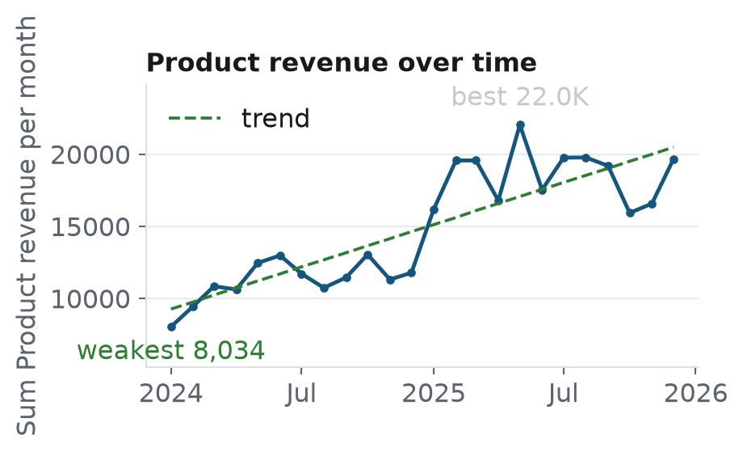

**What we see.** **Product revenue** (sum per month) shows a statistically significant upward trend (about +75% across the period, p<0.001). Best month: 2025-05-01 (22.0K); weakest: 2024-01-01 (8,034). The first and last months may be partial.

**Why it matters.** Product revenue has risen about 75% over the period (p<0.001), with a peak in May 2025 and a low in Jan 2024, indicating strong overall growth but seasonal swings.

**How much to trust it.** Based on 24 monthly data points (5,846 rows).

#### Payment Method = Cash on Delivery has the highest Product revenue (average 64.6 per record vs 57.7 for Bank Transfer), ahead of Bank Transfer (negligible effect)

*Product revenue by Payment Method* · confidence: **Low** · f5, f34

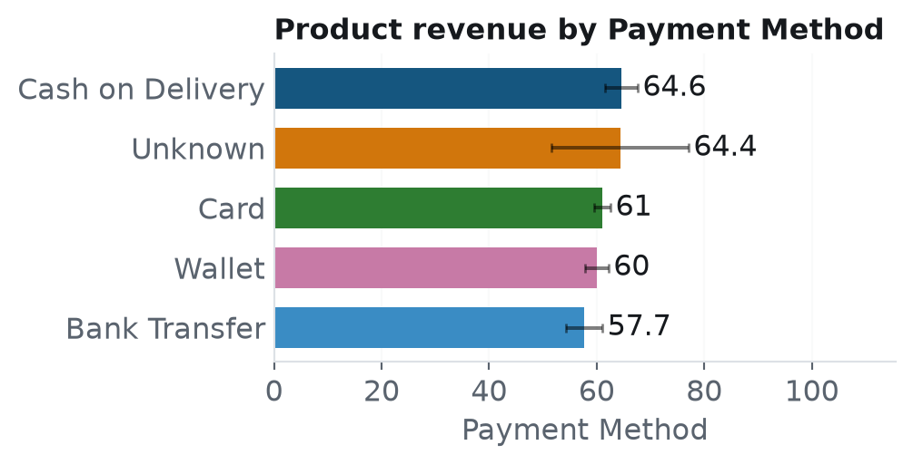

**What we see.** Average **Product revenue** is highest for **Payment Method = Cash on Delivery** (64.6) and lowest for **Bank Transfer** (57.7). The difference is statistically significant (ANOVA p=0.0296, eta²=0.002, negligible effect).

**Why it matters.** Cash on Delivery yields a higher average Product revenue (64.6) than Bank Transfer (57.7) with statistical significance (p=0.0296) but a negligible effect size.

**How much to trust it.** Significant on its own but NOT after correcting for multiple comparisons: treat as a lead. Only a negligible effect: detectable but may not matter in practice. Only just significant (p = 0.030); a little more or less data could change the verdict. Based on 5,846 rows.

- Median check (Kruskal-Wallis): the difference does NOT hold, p=0.15.

#### Return Refund Total and Return Refund Avg move together (r = +1.00)

*Relationships between numeric columns* · confidence: **Medium** · f3

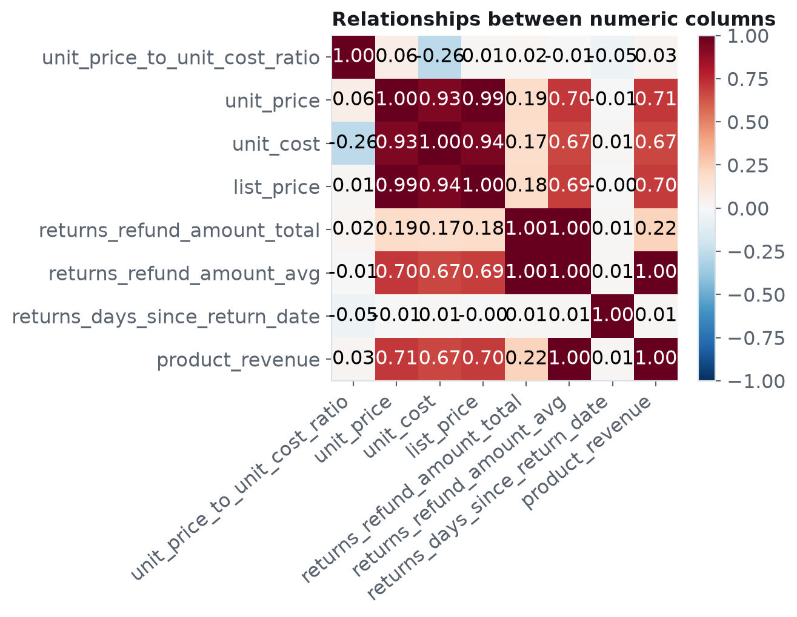

**What we see.** Strongest relationships: Return Refund Total & Return Refund Avg: r=1.00; Unit Price & List Price: r=0.99; Unit Cost & List Price: r=0.94. Correlation shows columns move together, not that one causes the other. Unit price to unit cost ratio is a ratio, so these correlations use its per-row values (not a group-level ratio of sums). Not reported because one column is calculated from the other: Unit Price = Unit Cost × Unit price to unit cost ratio; Return Refund Avg = quantity × Unit Price; Product revenue = quantity × Unit Price.

**Why it matters.** Total and average refund amounts move together perfectly (r=1.00), suggesting refunds are proportionally consistent across orders and may impact net revenue predictably.

**How much to trust it.** Strongest correlation is r = 1.00. Correlation does not show cause and effect.

#### The top 3 category values account for 78% of total Product revenue

*Where Product revenue comes from (category)* · confidence: **Descriptive** · f8

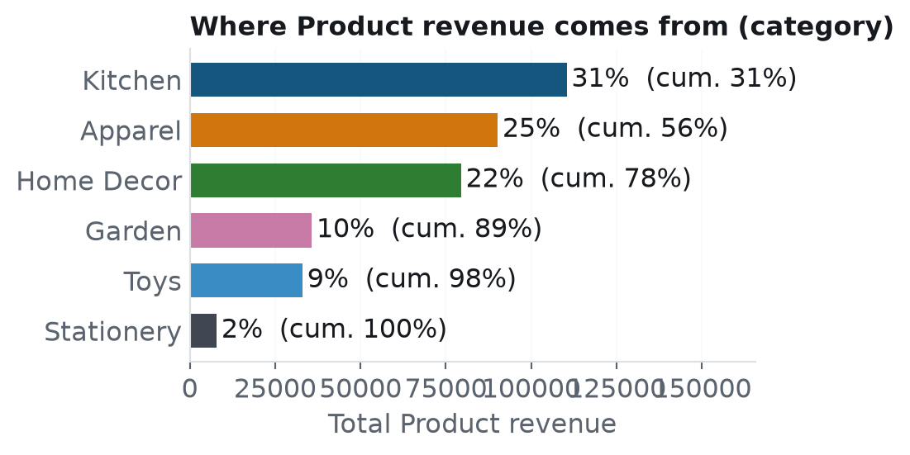

**What we see.** The top 3 values of **category** account for **78%** of total Product revenue (leader: Kitchen, 31%).

**Why it matters.** The top three categories generate 78% of total Product revenue, with Kitchen alone contributing 31%, highlighting revenue concentration.

**How much to trust it.** Describes the data as it is; no statistical claim is made.

#### Social Shop × Unknown stands out (average 75.2 per record); Marketplace × East is weakest (average 55.4 per record)

*Product revenue: Sales Channel × region* · confidence: **Exploratory** · f12

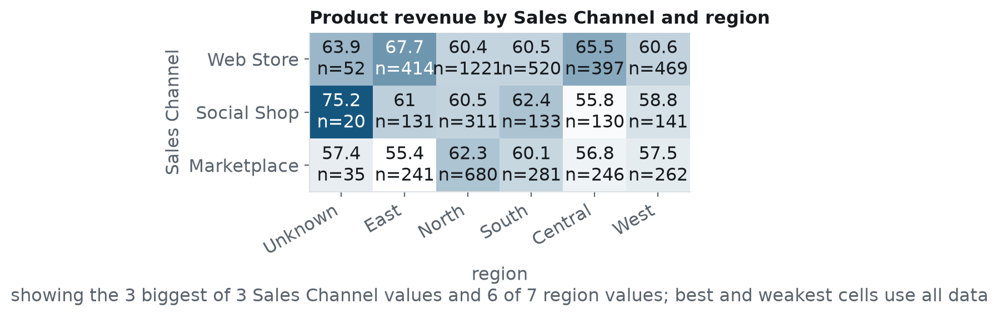

**What we see.** Across **Sales Channel** and **region**, **Product revenue** is highest for **Social Shop × Unknown** (75.2) and lowest for **Marketplace × East** (55.4), a 1.4× gap. Only combinations with at least 10 rows are shown; these cell-level gaps are not individually tested, so treat them as leads to check rather than proven differences. The chart draws only the 3 biggest Sales Channel and 6 biggest region values (of 3 and 7); the best and weakest cells are found over all data.

**Why it matters.** Segments can behave differently in combination, and single-column averages hide it. This shows where to look first, not what to do.

**How much to trust it.** Individual cells are not statistically tested; use them as leads to check. Based on 5,846 rows split into 21 cells.

Data profile (3 lines)

**Distributions**

- Product revenue: typical value 51.1, with half of rows between 29.8 and 83.3.
- Summary of 8 numeric columns.

**Outliers (one line per column)**

- **Product revenue:** 199 of 5,846 values (3.4%) lie above the upper fence (164).

Per-group figures: Unit price to unit cost ratio by Sales Channel (table)

| Group | Rows | Overall (ratio of sums) | Median |
|---|---|---|---|
| Social Shop | 904 | 2 | 1.99 |
| Web Store | 3173 | 2 | 1.99 |
| Marketplace | 1809 | 1.99 | 1.99 |

Per-group figures: Unit Price by Sales Channel (table)

| Group | Rows | Average | Median |
|---|---|---|---|
| Web Store | 3173 | 36.8 | 34.5 |
| Marketplace | 1809 | 36.4 | 34.5 |
| Social Shop | 904 | 36.4 | 34.1 |

Per-group figures: Unit Cost by Sales Channel (table)

| Group | Rows | Average | Median |
|---|---|---|---|
| Web Store | 3045 | 18.4 | 17.9 |
| Marketplace | 1721 | 18.2 | 17.9 |
| Social Shop | 871 | 18.2 | 17.9 |

Power BI

A ready-to-load Power BI pack (cleaned data, data model, DAX measures and visual specs) was generated alongside this report.

